# Agentic Safety Layer (ASL) — System Architecture

**Version:** 0.1  
**Status:** Pre-build architecture  
**Related:** [PROJECT_BRIEF.md](./PROJECT_BRIEF.md) · [PRODUCT_SPEC.md](./PRODUCT_SPEC.md) · [PLAN.md](./PLAN.md) · [RISKS.md](./RISKS.md)

---

## Table of Contents

1. [Executive Summary](#1-executive-summary)
2. [System Architecture](#2-system-architecture)
3. [Folder Structure](#3-folder-structure)
4. [API Architecture](#4-api-architecture)
5. [Database Schema](#5-database-schema)
6. [Authentication Flow](#6-authentication-flow)
7. [State Management](#7-state-management)
8. [Event Flow](#8-event-flow)
9. [Deployment Architecture](#9-deployment-architecture)
10. [Bottlenecks and Risks](#10-bottlenecks-and-risks)
11. [Architectural Decisions Log](#11-architectural-decisions-log)

---

## 1. Executive Summary

ASL is an **external governance control plane** that sits between agent runtimes (NexusFlow, OmniFlow, future frameworks) and production systems. Every sensitive tool call is evaluated synchronously against versioned policy; escalated actions enter a human approval workflow; every decision is persisted to an append-only audit store.

### Design Principles

| Principle | Architectural Implication |
|-----------|---------------------------|
| Enforce outside the agent | Thin HTTP/SDK client in runtimes; all policy logic in ASL |
| Policy is data, not code | YAML/JSON artifacts stored in DB; hot-reloaded on publish |
| Audit survives migration | Framework-agnostic normalized schema; no runtime coupling |
| Graduated risk | Risk taxonomy + composite rules drive decisions, not binary tool flags |
| Self-hostable by default | Single-tenant monolith; Docker Compose; no cloud dependencies |
| Build for yourself first | NexusFlow adapter is P0; framework adapters are incremental |

### v1 Scope Boundary

- **In scope:** Sync govern gate, policy engine, escalation queue, audit log, API key auth, CLI, minimal admin UI, Docker Compose
- **Out of scope:** Multi-tenant SaaS, SSO, HA clustering, batch govern, numeric risk scoring, framework adapters beyond NexusFlow/OmniFlow

> **v0 build subset (within v1 scope):** Of the components above, v0 implements only Govern Service, Policy Engine (rule-based, no composite context rules yet), and Audit Service — wired to PostgreSQL with the full schema in §5. Escalation Service exists but its "UI" is a terminal script (`scripts/approve.py`) that queries pending approvals and POSTs approve/reject. No admin UI, no CLI package, no SDK package, no Identity Service beyond a single hardcoded API key read from env.

---

## 2. System Architecture

### 2.1 High-Level Context Diagram

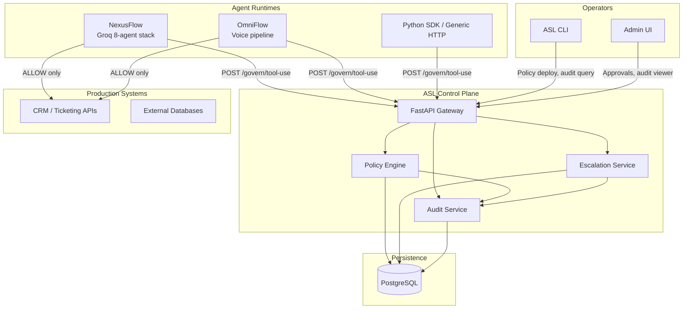

### 2.2 Component Architecture

ASL v1 is a **modular monolith** — one deployable FastAPI process with clear internal boundaries. This minimizes operational overhead for a solo builder while preserving seams for future extraction.

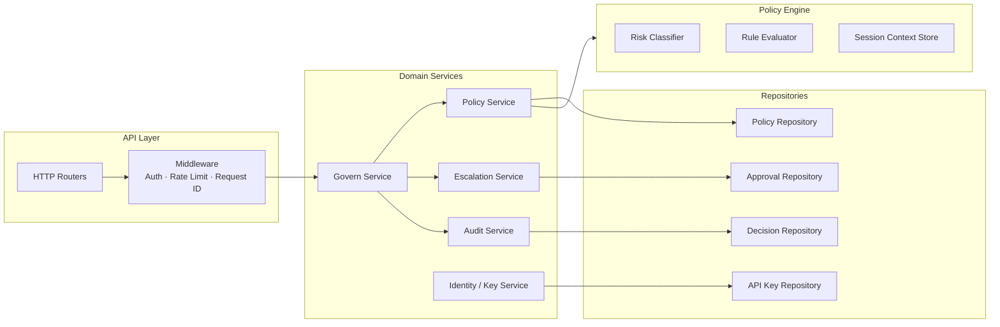

| Component | Responsibility | Latency Sensitivity |
|-----------|----------------|---------------------|
| **Govern Service** | Orchestrates evaluate → decide → persist → respond | Critical path (<100ms p95 for ALLOW) |
| **Policy Engine** | Classify tool risk; evaluate rules against request context | Critical path; must be in-memory |
| **Escalation Service** | Create pending approvals; resolve approve/reject; TTL enforcement | Off critical path for ESCALATE creation |
| **Audit Service** | Append-only decision records; query/export | Write on critical path; reads async |
| **Policy Service** | Version management; validation; publish/rollback; cache refresh | Off critical path except cache read |
| **Identity Service** | API key validation; scope enforcement | Critical path (cached) |

### 2.3 Request Lifecycle (ALLOW Path)

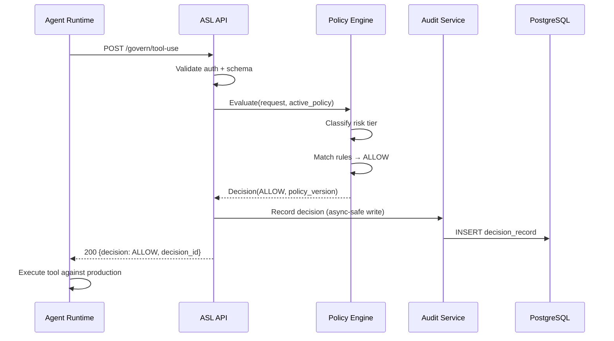

### 2.4 Technology Stack

| Layer | Choice | Rationale |
|-------|--------|-----------|
| API | Python 3.12 + FastAPI | Agent ecosystem alignment; fast iteration; OpenAPI native |
| Policy format | YAML (JSON-compatible) | Human-editable; version-controllable; CLI-friendly |
| Database | PostgreSQL 16 | ACID, append-only patterns, JSONB for flexible metadata |
| Local dev DB | SQLite (optional) | Zero-dependency local runs |
| Admin UI | React + Vite (SPA) | Component reuse for approval queue and audit tables |
| CLI | Typer | Consistent with Python stack |
| SDK | `asl-client` Python package | Thin HTTP wrapper with fail-mode helpers |
| Container | Docker Compose | Single-command self-host per product requirement |
| Migrations | Alembic | Standard SQLAlchemy migration path |

---

## 3. Folder Structure

Monorepo layout. All paths relative to repository root.

```
asl/
├── README.md
├── PROJECT_BRIEF.md
├── PRODUCT_SPEC.md
├── ARCHITECTURE.md
├── docker-compose.yml
├── docker-compose.dev.yml
├── .env.example
│
├── apps/
│   ├── api/                          # FastAPI backend (main deployable)
│   │   ├── pyproject.toml
│   │   ├── Dockerfile
│   │   ├── alembic.ini
│   │   ├── alembic/
│   │   │   └── versions/
│   │   └── src/
│   │       └── asl/
│   │           ├── __init__.py
│   │           ├── main.py                 # App factory, lifespan hooks
│   │           ├── config.py               # Settings via pydantic-settings
│   │           ├── dependencies.py         # DI: db session, current key
│   │           │
│   │           ├── api/                    # HTTP layer (thin)
│   │           │   ├── router.py           # Root router aggregation
│   │           │   ├── middleware/
│   │           │   │   ├── auth.py
│   │           │   │   ├── request_id.py
│   │           │   │   └── rate_limit.py
│   │           │   └── v1/
│   │           │       ├── govern.py       # POST /govern/tool-use
│   │           │       ├── approvals.py    # Approve/reject, poll status
│   │           │       ├── audit.py        # Query + export
│   │           │       ├── policies.py     # Deploy, list, rollback
│   │           │       ├── health.py       # /health, /ready
│   │           │       └── admin.py        # Keys, config
│   │           │
│   │           ├── domain/                 # Business logic
│   │           │   ├── models/             # Pydantic domain models
│   │           │   │   ├── govern.py
│   │           │   │   ├── policy.py
│   │           │   │   ├── approval.py
│   │           │   │   └── audit.py
│   │           │   ├── services/
│   │           │   │   ├── govern_service.py
│   │           │   │   ├── policy_service.py
│   │           │   │   ├── escalation_service.py
│   │           │   │   ├── audit_service.py
│   │           │   │   └── identity_service.py
│   │           │   └── exceptions.py
│   │           │
│   │           ├── engine/                 # Policy engine (pure logic)
│   │           │   ├── classifier.py       # Tool → risk tier
│   │           │   ├── evaluator.py        # Rule matching
│   │           │   ├── context.py          # Session context evaluation
│   │           │   └── schema.py           # Policy document schema
│   │           │
│   │           ├── persistence/            # Data access
│   │           │   ├── database.py
│   │           │   ├── models/             # SQLAlchemy ORM models
│   │           │   │   ├── policy.py
│   │           │   │   ├── decision.py
│   │           │   │   ├── approval.py
│   │           │   │   ├── api_key.py
│   │           │   │   └── session_context.py
│   │           │   └── repositories/
│   │           │       ├── policy_repo.py
│   │           │       ├── decision_repo.py
│   │           │       ├── approval_repo.py
│   │           │       └── key_repo.py
│   │           │
│   │           └── workers/                  # Background tasks (v1 minimal)
│   │               ├── ttl_worker.py         # Approval timeout enforcement
│   │               └── retention_worker.py   # Audit retention (P1)
│   │
│   ├── admin-ui/                     # React admin SPA
│   │   ├── package.json
│   │   ├── vite.config.ts
│   │   ├── Dockerfile
│   │   └── src/
│   │       ├── main.tsx
│   │       ├── api/                        # Typed API client
│   │       ├── pages/
│   │       │   ├── Approvals.tsx           # Pending queue
│   │       │   ├── Audit.tsx               # Audit viewer
│   │       │   └── Policy.tsx              # Active policy display
│   │       ├── components/
│   │       └── hooks/
│   │
│   └── cli/                          # Operator CLI
│       ├── pyproject.toml
│       └── src/
│           └── asl_cli/
│               ├── main.py
│               ├── commands/
│               │   ├── policy.py           # deploy, rollback, validate
│               │   ├── audit.py            # query, export
│               │   └── keys.py             # create, rotate, revoke
│               └── config.py
│
├── packages/
│   ├── asl-client/                   # Python SDK for agent runtimes
│   │   ├── pyproject.toml
│   │   └── src/
│   │       └── asl_client/
│   │           ├── client.py               # govern(), poll_approval()
│   │           ├── models.py
│   │           ├── fail_mode.py            # Circuit breaker + tier overrides
│   │           └── exceptions.py
│   │
│   └── asl-schemas/                  # Shared JSON schemas / OpenAPI types
│       ├── openapi/
│       │   └── asl-v1.yaml
│       └── jsonschema/
│           ├── govern-request.json
│           ├── govern-response.json
│           └── policy-v1.json
│
├── integrations/
│   ├── nexusflow/                    # NexusFlow pre-tool-call hook
│   │   └── hook.py
│   └── omniflow/                     # OmniFlow voice pipeline hook
│       └── hook.py
│
├── policies/
│   ├── examples/
│   │   └── default-policy.yaml
│   └── nexusflow/
│       └── tool-classifications.yaml
│
├── deploy/
│   ├── nginx/
│   │   └── nginx.conf                # Reverse proxy (optional TLS termination)
│   ├── scripts/
│   │   ├── init-db.sh
│   │   └── backup.sh
│   └── grafana/                      # Optional observability (P1)
│       └── dashboards/
│
├── tests/
│   ├── unit/
│   ├── integration/
│   └── e2e/
│
└── docs/
    ├── integration-guide.md
    ├── fail-mode-guide.md
    └── policy-authoring.md
```

### Package Boundaries

| Package | Depends On | Must Not Depend On |
|---------|------------|-------------------|
| `engine/` | `asl-schemas` only | FastAPI, SQLAlchemy, HTTP |
| `domain/services/` | `engine/`, `persistence/` | FastAPI routers |
| `api/` | `domain/` | Direct DB access |
| `asl-client` | `asl-schemas` | ASL server internals |
| `integrations/` | `asl-client` | ASL server internals |

---

## 4. API Architecture

### 4.1 API Design Principles

- **Versioned prefix:** All endpoints under `/api/v1/`
- **Resource-oriented** for admin/audit; **action-oriented** for govern (industry convention per ACP pattern)
- **Idempotent govern requests** via `Idempotency-Key` header (hash of tool + args + session + timestamp window)
- **Fail-fast validation** with structured error codes
- **OpenAPI 3.1** as contract source of truth, published at `/api/v1/openapi.json`

### 4.2 Endpoint Catalog

**v0** = implemented in [PLAN.md](./PLAN.md) Phases 0–2. **Deferred** = correct target API; not required to validate the core loop.

#### Governance (Runtime-Facing)

| v0 | Method | Path | Auth Scope | Description |
|----|--------|------|------------|-------------|
| **v0** | `POST` | `/api/v1/govern/tool-use` | `govern:write` | Synchronous policy evaluation |
| Deferred | `GET` | `/api/v1/govern/decisions/{decision_id}` | `govern:read` | Retrieve decision status (poll ESCALATE) |
| **v0** | `GET` | `/api/v1/health` | None | Liveness probe |
| Deferred | `GET` | `/api/v1/ready` | None | Readiness (DB + policy loaded) |

#### Human-in-the-Loop

| v0 | Method | Path | Auth Scope | Description |
|----|--------|------|------------|-------------|
| **v0** | `GET` | `/api/v1/approvals` | `admin:read` | List pending approvals (paginated; v0 may use raw SQL in `scripts/approve.py` instead) |
| Deferred | `GET` | `/api/v1/approvals/{approval_id}` | `admin:read` | Approval detail with full context |
| **v0** | `POST` | `/api/v1/approvals/{approval_id}/approve` | `admin:write` | Approve escalated action |
| **v0** | `POST` | `/api/v1/approvals/{approval_id}/reject` | `admin:write` | Reject with reason |
| **v0** | `GET` | `/api/v1/govern/decisions/{decision_id}/status` | `govern:read` | Runtime polls escalation resolution |

#### Audit

| v0 | Method | Path | Auth Scope | Description |
|----|--------|------|------------|-------------|
| Deferred | `GET` | `/api/v1/audit/decisions` | `audit:read` | Query decisions (filters, pagination) |
| Deferred | `GET` | `/api/v1/audit/decisions/{decision_id}` | `audit:read` | Single decision detail |
| Deferred | `POST` | `/api/v1/audit/export` | `audit:read` | Async export job (CSV/JSON) |
| Deferred | `GET` | `/api/v1/audit/export/{job_id}` | `audit:read` | Download export artifact |

#### Policy Management — **Deferred (v0)**

v0 ships one policy file loaded at startup, not a versioned policy deploy/rollback API.

| v0 | Method | Path | Auth Scope | Description |
|----|--------|------|------------|-------------|
| Deferred | `GET` | `/api/v1/policies/active` | `admin:read` | Current active policy metadata |
| Deferred | `GET` | `/api/v1/policies` | `admin:read` | List all policy versions |
| Deferred | `GET` | `/api/v1/policies/{version}` | `admin:read` | Specific version document |
| Deferred | `POST` | `/api/v1/policies` | `admin:write` | Upload + validate new policy version |
| Deferred | `POST` | `/api/v1/policies/{version}/activate` | `admin:write` | Activate version (rollback = activate older) |
| Deferred | `POST` | `/api/v1/policies/validate` | `admin:read` | Dry-run validation without persist |

#### Administration — **Deferred (v0)**

v0 uses a single API key from environment; no key management API.

| v0 | Method | Path | Auth Scope | Description |
|----|--------|------|------------|-------------|
| Deferred | `GET` | `/api/v1/admin/keys` | `admin:write` | List API keys (metadata only) |
| Deferred | `POST` | `/api/v1/admin/keys` | `admin:write` | Create scoped API key |
| Deferred | `DELETE` | `/api/v1/admin/keys/{key_id}` | `admin:write` | Revoke key |
| Deferred | `GET` | `/api/v1/admin/config` | `admin:read` | Fail-mode and system config |
| Deferred | `PATCH` | `/api/v1/admin/config` | `admin:write` | Update fail-mode config |

### 4.3 Govern Request Contract

**`POST /api/v1/govern/tool-use`**

```
Headers:
  Authorization: Bearer <api_key>
  Idempotency-Key: <optional, recommended>
  X-Request-ID: <optional, echoed in response>

Request Body:
{
  "tool": "update_ticket",                    // required, string
  "arguments": { "ticket_id": "T-123", ... }, // required, object
  "agent_id": "nexusflow/support-agent",      // required, string
  "session_id": "sess_abc123",                // required, string
  "timestamp": "2026-06-28T10:00:00Z",        // required, ISO 8601 UTC
  "principal": {                              // required
    "type": "user",                         // user | service | anonymous
    "id": "user:U42"
  },
  "delegation_chain": [                       // optional, ordered
    { "agent_id": "orchestrator", "role": "orchestrator" },
    { "agent_id": "support-agent", "role": "executor" }
  ],
  "metadata": {                               // optional bag
    "runtime": "nexusflow",
    "framework_version": "1.2.0"
  }
}
```

### 4.4 Govern Response Contract

```
200 OK:
{
  "decision": "ALLOW" | "DENY" | "ESCALATE",
  "decision_id": "dec_01H...",
  "policy_version": "v3",
  "risk_tier": "WRITE",
  "reason": "Matched rule: WRITE → ALLOW for trusted agents",
  "reason_code": "POLICY_ALLOW",
  "approval_id": "apr_01H...",              // present when ESCALATE
  "poll_url": "/api/v1/govern/decisions/dec_01H.../status",  // when ESCALATE
  "expires_at": "2026-06-28T10:05:00Z"      // approval TTL when ESCALATE
}

403 Forbidden — DENY:
{
  "decision": "DENY",
  "decision_id": "dec_01H...",
  "policy_version": "v3",
  "risk_tier": "DESTRUCTIVE",
  "reason": "Tool delete_record denied by policy",
  "reason_code": "POLICY_DENY"
}
```

### 4.5 Escalation Resume Protocol

**v1 decision: polling** (simplest; no webhook infrastructure required).

```mermaid
sequenceDiagram
    participant RT as Agent Runtime
    participant API as ASL API
    participant UI as Admin UI
    participant DB as PostgreSQL

    RT->>API: POST /govern/tool-use
    API-->>RT: ESCALATE {decision_id, poll_url, expires_at}
    RT->>RT: Hold tool execution; start poll loop

    UI->>API: GET /approvals (human reviews)
    UI->>API: POST /approvals/{id}/approve

    loop Every 2-5s until resolved or timeout
        RT->>API: GET /govern/decisions/{id}/status
        API->>DB: Check approval state
        API-->>RT: PENDING | APPROVED | REJECTED | EXPIRED
    end

    RT->>RT: Execute tool (APPROVED) or abort (REJECTED/EXPIRED)
```

**Agent-side timeout:** SDK defaults to `min(approval_ttl, agent_configured_timeout)`; on timeout, treat as `EXPIRED` (configurable: fail-closed default).

### 4.6 Error Model

| HTTP Status | Code | When |
|-------------|------|------|
| 400 | `VALIDATION_ERROR` | Malformed request body |
| 401 | `UNAUTHORIZED` | Missing or invalid API key |
| 403 | `FORBIDDEN` | Valid key, insufficient scope |
| 404 | `NOT_FOUND` | Decision/approval/policy not found |
| 409 | `CONFLICT` | Concurrent approval resolution |
| 422 | `POLICY_ERROR` | Policy evaluation internal error |
| 429 | `RATE_LIMITED` | Per-agent quota exceeded |
| 503 | `SERVICE_UNAVAILABLE` | DB unreachable; runtimes apply fail-mode |

All errors return:

```
{
  "error": {
    "code": "VALIDATION_ERROR",
    "message": "Human-readable description",
    "details": [...],
    "request_id": "req_01H..."
  }
}
```

### 4.7 Rate Limiting

| Scope | Default Limit | Window |
|-------|---------------|--------|
| Per API key (govern) | 300 req/min | Sliding window |
| Per agent_id | 60 req/min | Prevents runaway loops |
| Per API key (admin) | 60 req/min | Protects admin endpoints |

Implemented in middleware with in-memory token bucket (v1). Redis-backed limiter deferred to Phase 6.

---

## 5. Database Schema

### 5.1 Entity Relationship Diagram

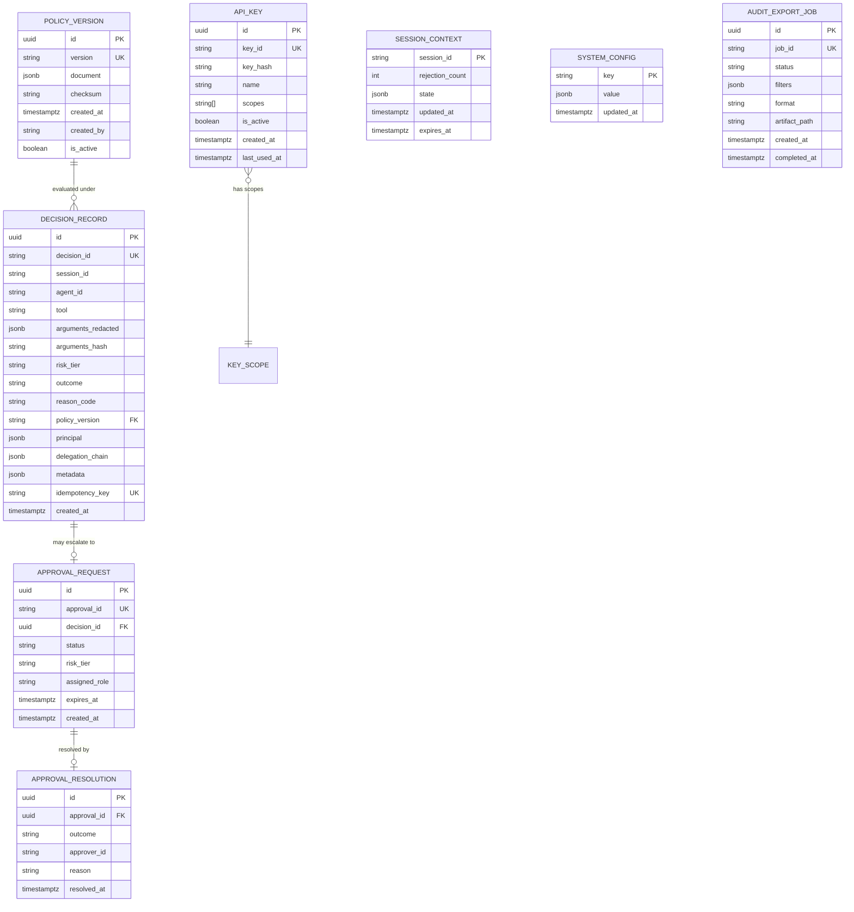

### 5.2 Table Definitions

#### `policy_versions`

| Column | Type | Constraints | Notes |
|--------|------|-------------|-------|
| `id` | `UUID` | PK | Internal |
| `version` | `VARCHAR(32)` | UNIQUE, NOT NULL | e.g. `v1`, `v4` |
| `document` | `JSONB` | NOT NULL | Full policy artifact |
| `checksum` | `VARCHAR(64)` | NOT NULL | SHA-256 of canonical document |
| `created_at` | `TIMESTAMPTZ` | NOT NULL, DEFAULT now() | |
| `created_by` | `VARCHAR(128)` | | Operator identity |
| `is_active` | `BOOLEAN` | NOT NULL, DEFAULT false | Only one active (enforced by partial unique index) |

**Index:** `UNIQUE (is_active) WHERE is_active = true` — enforces single active policy.

#### `decision_records` (Append-Only)

| Column | Type | Constraints | Notes |
|--------|------|-------------|-------|
| `id` | `UUID` | PK | |
| `decision_id` | `VARCHAR(32)` | UNIQUE, NOT NULL | External ID (`dec_*`) |
| `session_id` | `VARCHAR(128)` | NOT NULL | |
| `agent_id` | `VARCHAR(128)` | NOT NULL | |
| `tool` | `VARCHAR(256)` | NOT NULL | |
| `arguments_redacted` | `JSONB` | NOT NULL | PII/secrets redacted |
| `arguments_hash` | `VARCHAR(64)` | NOT NULL | SHA-256 of raw args |
| `risk_tier` | `VARCHAR(16)` | NOT NULL | READ/WRITE/DESTRUCTIVE/CRITICAL |
| `outcome` | `VARCHAR(16)` | NOT NULL | ALLOW/DENY/ESCALATE |
| `reason_code` | `VARCHAR(64)` | NOT NULL | Machine-readable |
| `policy_version` | `VARCHAR(32)` | NOT NULL, FK | |
| `principal` | `JSONB` | NOT NULL | |
| `delegation_chain` | `JSONB` | DEFAULT `[]` | |
| `metadata` | `JSONB` | DEFAULT `{}` | |
| `idempotency_key` | `VARCHAR(128)` | UNIQUE, nullable | Dedup window: 24h |
| `created_at` | `TIMESTAMPTZ` | NOT NULL, DEFAULT now() | Immutable |

**Indexes:**
- `(session_id, created_at DESC)` — incident reconstruction
- `(agent_id, created_at DESC)` — per-agent audit
- `(policy_version, created_at DESC)` — policy impact analysis
- `(outcome, created_at DESC)` — escalation/deny reports
- `(created_at)` — retention partitioning (future)

**Immutability:** Application layer rejects UPDATE/DELETE. DB role for API process has INSERT + SELECT only on this table.

#### `approval_requests`

| Column | Type | Constraints | Notes |
|--------|------|-------------|-------|
| `id` | `UUID` | PK | |
| `approval_id` | `VARCHAR(32)` | UNIQUE, NOT NULL | External ID (`apr_*`) |
| `decision_id` | `UUID` | FK → decision_records, NOT NULL | |
| `status` | `VARCHAR(16)` | NOT NULL | PENDING/APPROVED/REJECTED/EXPIRED |
| `risk_tier` | `VARCHAR(16)` | NOT NULL | Determines approver routing |
| `assigned_role` | `VARCHAR(64)` | | e.g. `admin`, `team_lead` |
| `expires_at` | `TIMESTAMPTZ` | NOT NULL | TTL deadline |
| `created_at` | `TIMESTAMPTZ` | NOT NULL, DEFAULT now() | |

**Index:** `(status, created_at) WHERE status = 'PENDING'` — approval queue.

#### `approval_resolutions`

| Column | Type | Constraints | Notes |
|--------|------|-------------|-------|
| `id` | `UUID` | PK | |
| `approval_id` | `UUID` | FK → approval_requests, UNIQUE | One resolution per approval |
| `outcome` | `VARCHAR(16)` | NOT NULL | APPROVED/REJECTED |
| `approver_id` | `VARCHAR(128)` | NOT NULL | Human identity |
| `reason` | `TEXT` | | Rejection comment |
| `resolved_at` | `TIMESTAMPTZ` | NOT NULL, DEFAULT now() | |

**Concurrency:** `UPDATE approval_requests SET status = :new WHERE approval_id = :id AND status = 'PENDING'` — optimistic lock; 409 on conflict.

#### `session_context`

| Column | Type | Constraints | Notes |
|--------|------|-------------|-------|
| `session_id` | `VARCHAR(128)` | PK | |
| `rejection_count` | `INTEGER` | NOT NULL, DEFAULT 0 | For composite rules |
| `state` | `JSONB` | DEFAULT `{}` | Extensible session state |
| `updated_at` | `TIMESTAMPTZ` | NOT NULL | |
| `expires_at` | `TIMESTAMPTZ` | NOT NULL | Default TTL: 24h |

#### `api_keys`

| Column | Type | Constraints | Notes |
|--------|------|-------------|-------|
| `id` | `UUID` | PK | |
| `key_id` | `VARCHAR(32)` | UNIQUE, NOT NULL | Public identifier |
| `key_hash` | `VARCHAR(128)` | NOT NULL | bcrypt hash; never store plaintext |
| `name` | `VARCHAR(128)` | NOT NULL | Human label |
| `scopes` | `TEXT[]` | NOT NULL | govern:read, govern:write, admin:*, audit:read |
| `is_active` | `BOOLEAN` | NOT NULL, DEFAULT true | Soft revoke |
| `created_at` | `TIMESTAMPTZ` | NOT NULL | |
| `last_used_at` | `TIMESTAMPTZ` | | Updated async |

#### `system_config`

| Column | Type | Notes |
|--------|------|-------|
| `key` | `VARCHAR(64)` PK | e.g. `fail_mode`, `approval_ttl` |
| `value` | `JSONB` | Structured config |
| `updated_at` | `TIMESTAMPTZ` | |

### 5.3 Argument Redaction Policy

| Field Pattern | Storage |
|---------------|---------|
| `password`, `secret`, `token`, `api_key` | Replaced with `[REDACTED]` |
| `email`, `phone` | Hashed + partial mask (`j***@example.com`) |
| All other fields | Stored as-is in `arguments_redacted` |
| Full arguments | Never stored; `arguments_hash` only for integrity |

### 5.4 Retention

| Data | Default Retention | Configurable |
|------|-------------------|--------------|
| Decision records | 365 days | Yes, via `system_config` |
| Approval records | 365 days | Linked to decisions |
| Session context | 24 hours | TTL on row |
| Export artifacts | 7 days | Filesystem cleanup job |

---

## 6. Authentication Flow

### 6.1 Auth Model (v1)

ASL v1 uses **API key bearer tokens** only. No SSO, no OAuth, no user sessions for runtimes. Admin UI authenticates via a dedicated admin API key stored in browser session storage (or HTTP-only cookie set by a thin login proxy in Phase 2).

**Key scopes:**

| Scope | Grants |
|-------|--------|
| `govern:write` | POST `/govern/tool-use` |
| `govern:read` | GET decision status (poll) |
| `audit:read` | Query and export audit |
| `admin:read` | View policies, config, pending approvals |
| `admin:write` | Deploy policy, approve/reject, manage keys |

Keys are **scoped and rotatable**. Recommended: separate keys per runtime (NexusFlow, OmniFlow) with `govern:*` only; operator key with `admin:*` + `audit:read`.

### 6.2 Runtime Authentication Flow

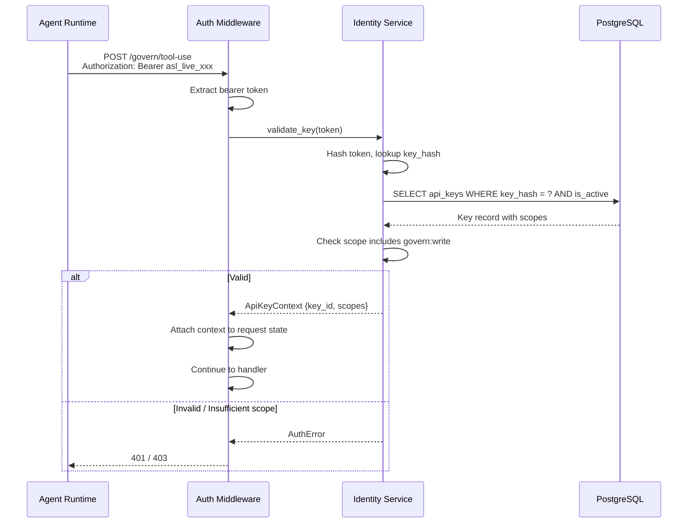

### 6.3 Admin UI Authentication Flow (v1)

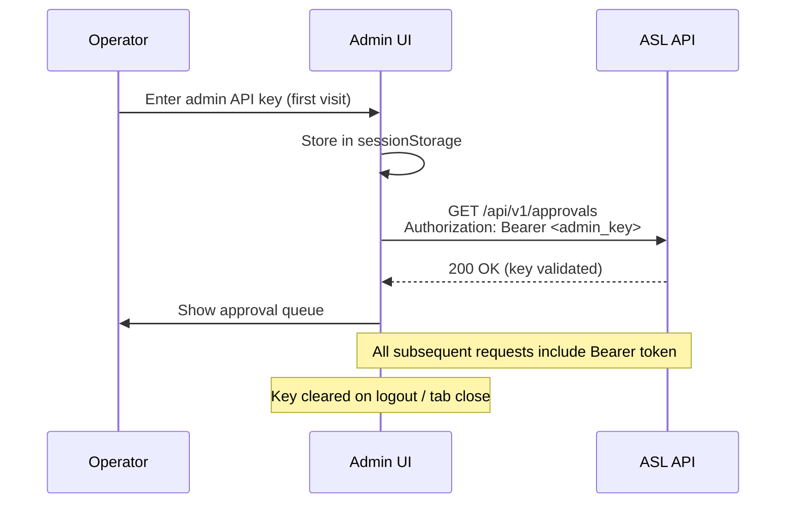

**Phase 2 upgrade path:** Replace raw key entry with username/password → server issues short-lived JWT backed by `admin_users` table. v1 intentionally avoids this complexity.

### 6.4 API Key Lifecycle

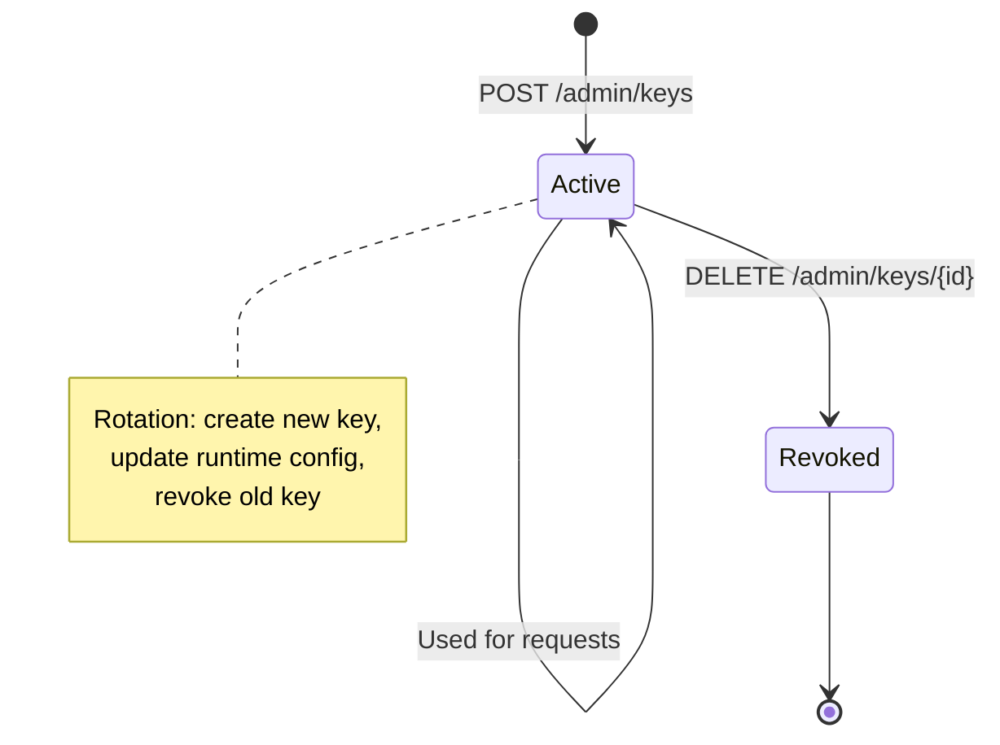

**Rotation without downtime:**
1. Create new key with same scopes
2. Update runtime env vars (rolling restart)
3. Revoke old key after all runtimes migrated

### 6.5 Agent Identity vs API Key Identity

| Identity | Source | Purpose |
|----------|--------|---------|
| **API key** | `Authorization` header | Authenticates the *runtime* calling ASL |
| **agent_id** | Request body | Identifies which *agent* within the runtime initiated the action |
| **principal** | Request body | Identifies the *end user or service* on whose behalf the action runs |

`agent_id` is **claimed, not cryptographically verified** in v1. Runtimes with `govern:write` are trusted to report accurate agent IDs. Phase 4 may add per-agent credential binding.

---

## 7. State Management

### 7.1 State Categories

| State Type | Owner | Storage | Mutability |
|------------|-------|---------|------------|
| Active policy | Policy Service | In-memory cache + `policy_versions` table | Replaced on publish |
| Decision records | Audit Service | PostgreSQL (append-only) | Immutable |
| Approval workflow | Escalation Service | PostgreSQL (`approval_requests`) | State machine transitions |
| Session context | Policy Engine | PostgreSQL (`session_context`) | Mutable per session |
| API key cache | Identity Service | In-memory LRU (TTL 5min) | Refreshed on miss |
| Fail-mode config | Policy Service | `system_config` + runtime SDK config | Admin-updatable |
| Admin UI state | React SPA | Browser (sessionStorage + React state) | Ephemeral |

### 7.2 Approval State Machine

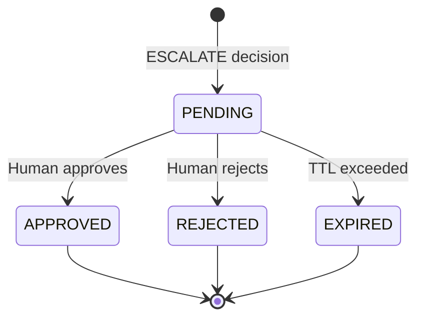

**Transition rules:**
- Only `PENDING` accepts approve/reject
- First resolver wins (optimistic concurrency)
- TTL worker transitions `PENDING → EXPIRED` (default action: auto-deny semantics for runtime)

### 7.3 Policy State

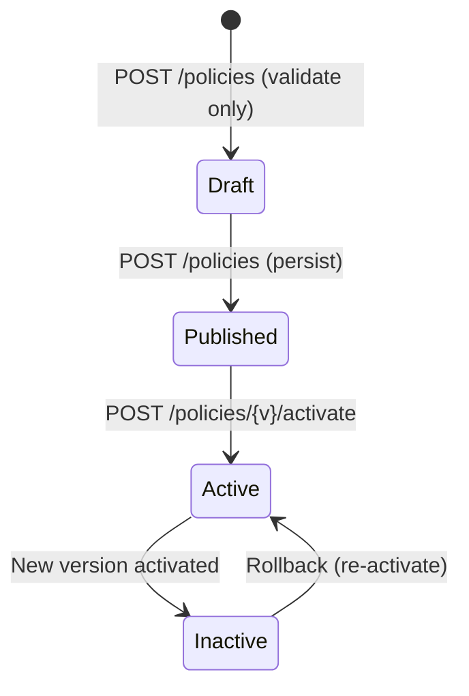

Active policy is held in a **process-local immutable snapshot**. On activation:
1. Validate document against schema
2. Persist to `policy_versions`
3. Deactivate previous version
4. Atomically swap in-memory pointer
5. Emit internal `PolicyActivated` event (for cache coherence in future multi-instance)

### 7.4 Admin UI State Management

| Concern | Approach |
|---------|----------|
| Server data | TanStack Query (React Query) — cache, refetch, polling for approval queue |
| Auth token | `sessionStorage` — admin API key |
| UI state | React `useState` / `useReducer` — filters, pagination, modals |
| Approval polling | Query `refetchInterval: 5000` on approvals page |
| Optimistic updates | Approve/reject with rollback on 409 conflict |

No global state library (Redux/Zustand) needed at v1 scale.

### 7.5 Runtime SDK State (Client-Side)

The `asl-client` SDK maintains:

| State | Purpose |
|-------|---------|
| Circuit breaker | Track ASL availability via `/health` |
| Fail-mode config | Per-tier overrides (READ open, DESTRUCTIVE closed) |
| Pending polls | Active escalation poll loops (cancel on session end) |

This state is **local to the agent process** — ASL does not manage runtime state.

---

## 8. Event Flow

### 8.1 Internal Event Bus (v1)

v1 uses a **lightweight in-process event dispatcher** (Python `asyncio` callbacks or blinker signals). No external message broker.

| Event | Publisher | Subscribers |
|-------|-----------|-------------|
| `DecisionMade` | Govern Service | Audit Service (persist), Metrics |
| `ApprovalCreated` | Escalation Service | Audit Service, Metrics |
| `ApprovalResolved` | Escalation Service | Audit Service (update), Metrics |
| `PolicyActivated` | Policy Service | Policy Engine (cache swap), Metrics |
| `ApprovalExpired` | TTL Worker | Escalation Service, Audit Service |

### 8.2 End-to-End Event Flow: ESCALATE Path

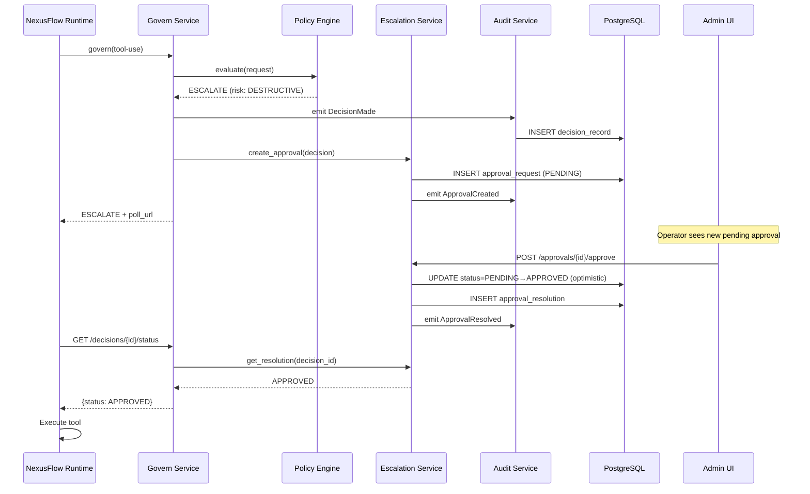

### 8.3 End-to-End Event Flow: Policy Deploy

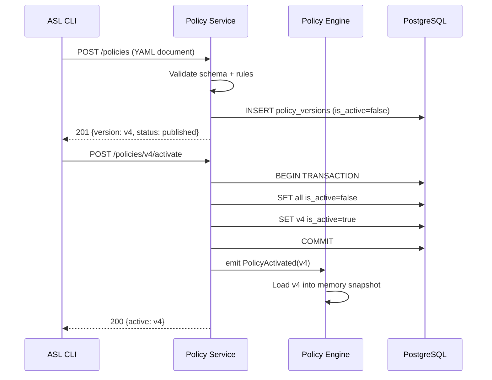

### 8.4 Fail-Mode Event Flow (ASL Unavailable)

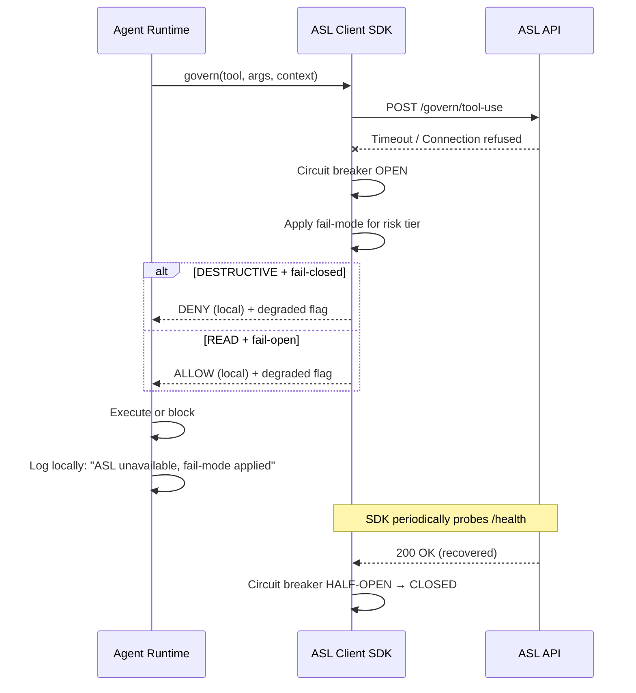

### 8.5 Future Event Architecture (Phase 4+)

When webhook notifications and multi-instance HA are needed:

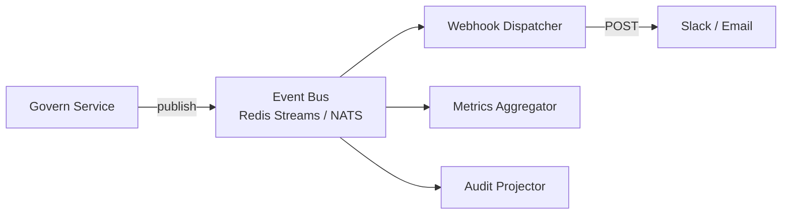

Not built in v1. Polling and in-process events are sufficient.

---

## 9. Deployment Architecture

### 9.1 Production Topology (Single VPS)

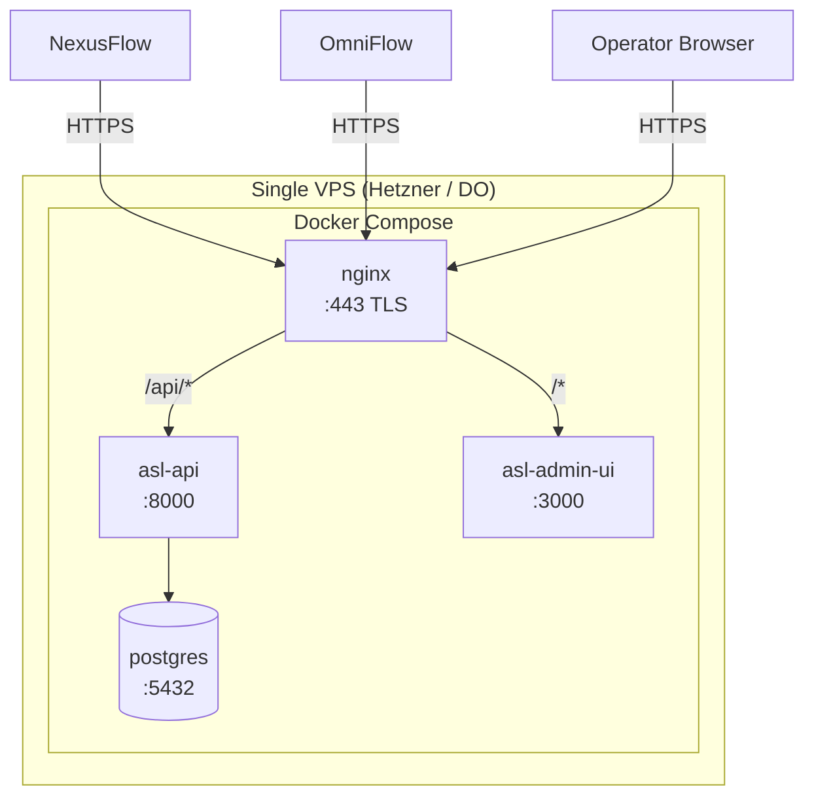

### 9.2 Docker Compose Services

| Service | Image | Ports | Volumes |
|---------|-------|-------|---------|
| `postgres` | `postgres:16-alpine` | 5432 (internal) | `pgdata:/var/lib/postgresql/data` |
| `api` | `asl-api:latest` | 8000 (internal) | — |
| `admin-ui` | `asl-admin-ui:latest` | 3000 (internal) | — |
| `nginx` | `nginx:alpine` | 443, 80 | `./deploy/nginx/nginx.conf`, TLS certs |

**Optional (P1):**
| Service | Purpose |
|---------|---------|
| `backup-sidecar` | Nightly `pg_dump` to mounted volume |
| `prometheus` + `grafana` | Metrics dashboards |

### 9.3 Local Development Topology

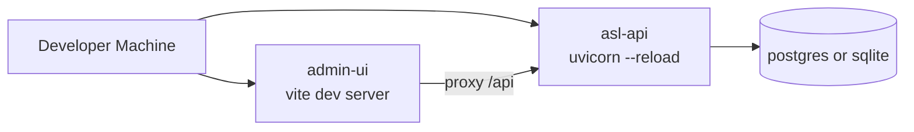

`docker-compose.dev.yml` runs only PostgreSQL; API and UI run natively with hot reload.

### 9.4 Environment Configuration

| Variable | Service | Description |
|----------|---------|-------------|
| `DATABASE_URL` | api | PostgreSQL connection string |
| `ASL_SECRET_KEY` | api | Internal signing secret |
| `ASL_LOG_LEVEL` | api | `INFO` / `DEBUG` |
| `ASL_CORS_ORIGINS` | api | Admin UI origin |
| `ASL_DEFAULT_APPROVAL_TTL` | api | Seconds (default: 300) |
| `ASL_RATE_LIMIT_GOVERN` | api | Requests/min per key |
| `VITE_API_BASE_URL` | admin-ui | API endpoint for browser |
| `POSTGRES_PASSWORD` | postgres | DB password |

### 9.5 Health Checks and Startup Order

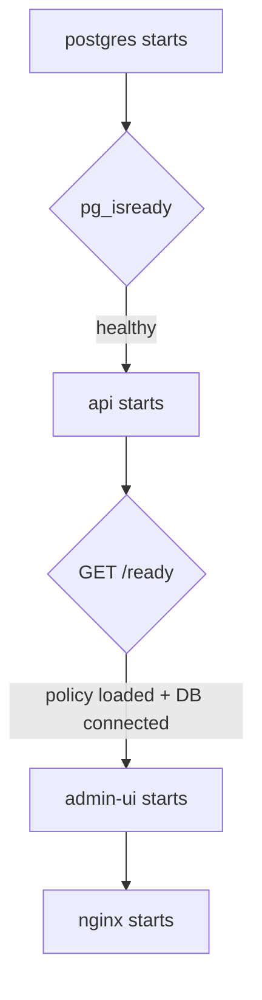

| Endpoint | Purpose | Healthy When |
|----------|---------|--------------|
| `/api/v1/health` | Liveness | Process responding |
| `/api/v1/ready` | Readiness | DB connected + active policy loaded |

### 9.6 Backup and Recovery

| Concern | v1 Approach |
|---------|-------------|
| DB backup | Daily `pg_dump` via cron script in `deploy/scripts/backup.sh` |
| Policy backup | Policy versions in DB; also keep YAML in Git |
| Recovery | Restore dump → restart API → policy auto-loads from DB |
| RPO | 24 hours (daily backup) |
| RTO | <1 hour (manual restore) |

### 9.7 Future HA Topology (Phase 6 — Not v1)

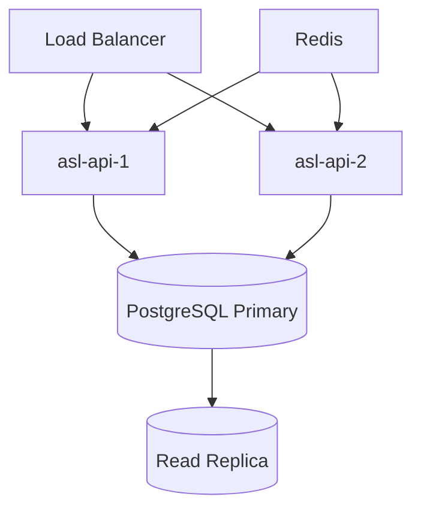

Required for: shared rate limiting, policy cache invalidation, webhook delivery guarantees.

---

## 10. Bottlenecks and Risks

### 10.1 Performance Bottlenecks

| Bottleneck | Impact | Likelihood (v1) | Mitigation |
|------------|--------|-----------------|------------|
| **Sync govern gate latency** | Agent UX degradation; voice pipeline unacceptable delays | High | In-memory policy cache; no DB read on ALLOW path except audit write; target <100ms p95; async audit write if needed |
| **Audit write on critical path** | Every ALLOW blocked on DB INSERT | Medium | Use async write with synchronous fallback for ESCALATE; batch inserts for high throughput (Phase 6) |
| **PostgreSQL single instance** | Write throughput ceiling ~1-5k inserts/sec | Low (v1) | Sufficient for solo/small team; partition `decision_records` by month when >10M rows |
| **Escalation polling** | N agents × poll interval = read load | Medium | Exponential backoff (2s → 5s → 10s); webhook upgrade in Phase 4 |
| **Policy evaluation complexity** | Rule count growth slows evaluation | Low (v1) | Compile rules to decision tree on load; benchmark on deploy |
| **Single VPS** | CPU/memory ceiling; no redundancy | High | Accept for v1; fail-mode in runtimes; document HA path |
| **In-memory rate limiter** | Resets on restart; not shared across instances | Low (v1) | Acceptable for single instance; Redis in Phase 6 |
| **Admin UI polling** | Unnecessary load with many operators | Low | WebSocket/SSE for approval queue in Phase 2 |

### 10.2 Security Risks

| Risk | Severity | Mitigation |
|------|----------|------------|
| **API key leakage** | Critical | Scoped keys; rotation CLI; separate govern vs admin keys; never log keys |
| **Forged delegation chains** | High | v1: trust runtime; document that chains are claims; Phase 4: signed delegation tokens |
| **Policy misconfiguration** | Critical | Schema validation on deploy; default-deny for unclassified tools; staging/dry-run mode (Phase 4) |
| **PII in audit log** | High | Redaction rules; argument hashing; retention limits; export access restricted to `audit:read` |
| **Approval queue spam** | Medium | Rate limiting per agent; auto-expire pending approvals |
| **SQL injection / XSS** | Medium | SQLAlchemy ORM; React default escaping; CSP headers on admin UI |
| **Denial of service** | Medium | Rate limiting; request size limits (1MB max payload); circuit breaker in SDK |

### 10.3 Operational Risks

| Risk | Severity | Mitigation |
|------|----------|------------|
| **ASL outage = governance blackout** | High | Fail-mode per risk tier; health endpoint; runtime SDK circuit breaker; operator alerting |
| **Stale approval queue** | Medium | Approval TTL (default 5min); auto-expire; agent-side timeout |
| **Audit log unbounded growth** | Medium | Retention policy; date partitioning; export + archive |
| **Policy deploy breaks production** | Critical | Validate before activate; rollback via activate previous version; keep policies in Git |
| **Backup failure** | High | Monitor backup job; test restore quarterly |
| **Single operator unavailable** | Medium | Risk-tiered routing (Phase 2); approval TTL with auto-escalate |

### 10.4 Architectural Risks

| Risk | Severity | Mitigation |
|------|----------|------------|
| **Monolith scaling limits** | Low (v1) | Clean module boundaries enable extraction; don't premature-split |
| **Schema rigidity for delegation** | Medium | Extensible `metadata` bag; versioned request schema (`schema_version` field) |
| **Polling-based escalation doesn't scale** | Medium | Document webhook upgrade path; SDK abstracts transport |
| **No multi-tenancy** | Low (v1) | Explicit non-goal; schema uses single-tenant assumptions |
| **SQLite/PostgreSQL drift** | Low | CI tests against PostgreSQL only; SQLite for local dev convenience |
| **Policy engine in Python** | Low | Sufficient for rule-based v1; consider Rust hot path only if profiling demands |

### 10.5 Product-Architecture Alignment Risks

| Risk | Concern | Architectural Response |
|------|---------|------------------------|
| Scope creep to enterprise control plane | Over-engineering | Modular monolith; strict v1 endpoint set; non-goals documented |
| Framework adapter demand | Distraction from NexusFlow | `asl-client` SDK is the integration surface; adapters are thin wrappers |
| Compliance certification pressure | Legal exposure | Audit primitives only; no compliance claims in architecture |
| Voice pipeline latency (OmniFlow) | Sync gate too slow | Pre-classify known-safe tools; cache recent decisions by session+tool hash (P1) |

---

## 11. Architectural Decisions Log

Decisions made here resolve open items from [PRODUCT_SPEC.md §7](./PRODUCT_SPEC.md#7-missing-requirements). Revisit as phases complete.

| ID | Decision | Rationale | Alternatives Rejected |
|----|----------|-----------|----------------------|
| ADR-001 | Modular monolith over microservices | Solo team; single VPS; ops simplicity | Microservices (ops burden), serverless (cold start latency) |
| ADR-002 | Polling for escalation resume (v1) | No webhook infra; works behind NAT | Webhooks (Phase 4), long-poll (complexity) |
| ADR-003 | API key auth only (v1) | Sufficient for self-hosted single-tenant | OAuth/SSO (enterprise scope), mTLS (complexity) |
| ADR-004 | PostgreSQL append-only audit | ACID, immutability via DB permissions | Event store (overkill), file-based log (query pain) |
| ADR-005 | In-memory policy cache | Sub-millisecond evaluation; hot reload on activate | Per-request DB read (latency), Redis cache (dependency) |
| ADR-006 | Trust runtime for agent_id and delegation chain | v1 has no agent registry; NexusFlow is trusted consumer | Signed delegation tokens (Phase 4) |
| ADR-007 | Idempotency via header + 24h dedup window | Prevents duplicate decisions on retry | Exactly-once delivery (impossible over HTTP) |
| ADR-008 | Optimistic concurrency on approvals | Simple; first resolver wins; 409 on conflict | Pessimistic locking (DB hold), multi-approve (confusing) |
| ADR-009 | Argument redaction in audit service | Centralized; consistent; configurable patterns | Redact in runtime (inconsistent), store raw (PII risk) |
| ADR-010 | React SPA for admin UI | Table-heavy views; polling; component ecosystem | Plain HTML (harder to maintain), full dashboard framework (overkill) |
| ADR-011 | YAML policy format | Human-editable; Git-friendly; CLI deploy | Python policy modules (couples policy to code), OPA/Rego (learning curve) |
| ADR-012 | UTC timestamps everywhere | Audit consistency; compliance clarity | Local timezone storage (ambiguity) |

---

## Appendix A: Policy Document Structure (v1 Schema)

```yaml
# policies/examples/default-policy.yaml
schema_version: "1.0"
version: "v1"
metadata:
  name: "Default ASL Policy"
  description: "Baseline rules for NexusFlow"

tool_classifications:
  get_ticket: READ
  list_tickets: READ
  update_ticket: WRITE
  create_ticket: WRITE
  delete_ticket: DESTRUCTIVE
  purge_database: CRITICAL

default_unclassified: ESCALATE  # DENY | ESCALATE | ALLOW

rules:
  - name: "Allow reads"
    when:
      risk_tier: READ
    then: ALLOW

  - name: "Escalate destructive"
    when:
      risk_tier: DESTRUCTIVE
    then: ESCALATE

  - name: "Escalate critical"
    when:
      risk_tier: CRITICAL
    then: ESCALATE

  - name: "Deny after repeated rejections"
    when:
      risk_tier: [WRITE, DESTRUCTIVE]
      session_rejection_count_gte: 3
    then: DENY

fail_mode:
  default: fail-closed
  per_tier:
    READ: fail-open
    WRITE: fail-closed
    DESTRUCTIVE: fail-closed
    CRITICAL: fail-closed

approval:
  default_ttl_seconds: 300
  routing:
    DESTRUCTIVE: team_lead
    CRITICAL: admin
```

---

## Appendix B: Observability (P1)

| Signal | Implementation |
|--------|----------------|
| **Metrics** | Prometheus client: `asl_decisions_total`, `asl_decision_latency_seconds`, `asl_pending_approvals`, `asl_policy_version` |
| **Logging** | Structured JSON logs with `request_id`, `decision_id`, `agent_id`, `outcome` |
| **Tracing** | OpenTelemetry (Phase 2) — trace govern request end-to-end |
| **Alerting** | Grafana alerts: approval queue depth >10, p95 latency >200ms, error rate >1% |

---

## Appendix C: Integration Contract Summary

```
Runtime Integration Checklist:
  □ Install asl-client SDK
  □ Configure ASL_BASE_URL and ASL_API_KEY
  □ Insert pre-tool-call hook before production API calls
  □ Pass tool, arguments, agent_id, session_id, principal
  □ Include delegation_chain for multi-hop agents
  □ Branch on ALLOW / DENY / ESCALATE
  □ Poll decision status for ESCALATE (or use SDK helper)
  □ Configure fail-mode per risk tier
  □ Register health check probe for circuit breaker
```

---

*This document is the architecture source of truth for ASL v0.1. Update as ADRs are superseded and phases complete.*
