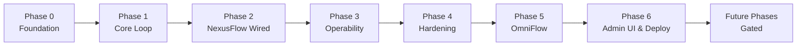
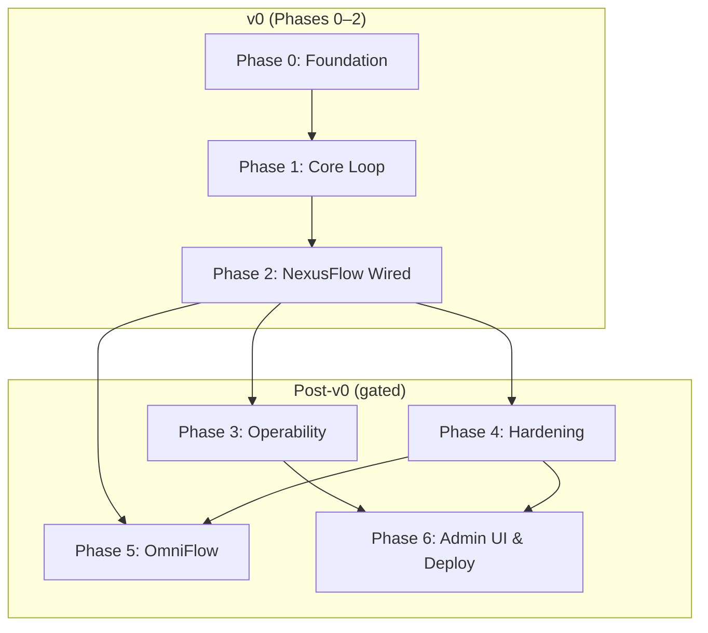

# Agentic Safety Layer (ASL) — Implementation Plan

**Version:** 0.1  
**Status:** Pre-build  
**Related:** [PROJECT_BRIEF.md](./PROJECT_BRIEF.md) · [PRODUCT_SPEC.md](./PRODUCT_SPEC.md) · [ARCHITECTURE.md](./ARCHITECTURE.md) · [RISKS.md](./RISKS.md)

---

## Plan Principles

1. **Risk-first** — Critical and High risks from [RISKS.md](./RISKS.md) are mitigated before features that depend on them.
2. **Contract before code** — OpenAPI and policy schema are locked before implementation diverges.
3. **NexusFlow before OmniFlow** — First real consumer validates the gate before voice latency work.
4. **CLI before UI** — Operator workflows work without frontend for solo-builder sustainability.
5. **Test at every gate** — No phase is complete without its testing checkpoint.
6. **Prove the loop before polishing the loop** — Phase 2 (NexusFlow wired) is the earliest point real value exists. Nothing after Phase 2 is justified by the plan alone; each later phase needs a specific, felt reason to start, not just "it's next on the list."

---

## Phase Overview



| Phase | Name | Primary Risk Focus |
|-------|------|-------------------|
| 0 | Foundation | M-04, TD-01, TD-13, M-10 |
| 1 | Core loop | DC-01, DC-02, SEC-01, TD-02, M-11 |
| 2 | NexusFlow wired | M-02, SEC-03, SEC-02, S-01 — **v0 finish line** |
| 3 | Operability | M-01, M-12, S-07, TD-11 |
| 4 | Hardening & composite rules | S-05, SEC-03, DC-04, SEC-02, SEC-09 |
| 5 | OmniFlow integration | S-01, UX-02, DC-07 |
| 6 | Admin UI & deployment | SEC-05, UX-03, S-03, M-08, SEC-11 |

**v0 = Phases 0–2.** Stop after Phase 2 and use the gate for real sessions before starting Phase 3. See [PROJECT_BRIEF.md § v0 Definition of Done](./PROJECT_BRIEF.md).

---

## Phase 0 — Foundation

**Goal:** Repo, full DB schema migrated, auth, and contracts exist — but minimal admin surface.

*Merged from former Phases 0–3: project setup, contracts & schemas, database, authentication (simplified).*

### Deliverables

**Project setup (former Phase 0)**

- Monorepo scaffold (`apps/api`, `packages/asl-schemas`, `integrations/`, `policies/`, `deploy/`, `tests/` — defer `apps/cli`, `packages/asl-client`, `apps/admin-ui` to later phases)
- Python project (`pyproject.toml`, FastAPI app skeleton, Alembic init)
- Docker Compose dev (`postgres` + `api`) + `.env.example`
- CI pipeline: lint, type-check, PostgreSQL-backed test job
- Import linter enforcing `engine/` has no FastAPI/SQLAlchemy imports (M-11)
- README with local dev quickstart and non-goals

**Contracts & schemas (former Phase 1)**

- OpenAPI 3.1 spec: `packages/asl-schemas/openapi/asl-v1.yaml`
  - `POST /govern/tool-use` request/response (v0 scope; other endpoints documented as deferred)
  - Error model, `schema_version` field
- JSON Schema: `policy-v1.json`, `govern-request.json`, `govern-response.json`
- **Policy rule precedence ADR** — first-match-wins, top-to-bottom; document in `docs/policy-authoring.md` (TD-02)
- Default `default_unclassified: ESCALATE` in example policy (SEC-01)
- Reason code catalog (`POLICY_ALLOW`, `POLICY_DENY`, `POLICY_ESCALATE`, etc.)
- Contract test scaffold (schemathesis or openapi diff in CI)

**Database (former Phase 2)**

- Alembic migrations for full schema per [ARCHITECTURE.md §5](./ARCHITECTURE.md):
  - `policy_versions` (partial unique index on `is_active`)
  - `decision_records` (append-only; all query indexes)
  - `approval_requests`, `approval_resolutions`
  - `session_context`
  - `api_keys`
  - `system_config`
- SQLAlchemy ORM models + repository layer
- DB bootstrap script (`deploy/scripts/init-db.sh`)
- Application DB role: `INSERT` + `SELECT` only on `decision_records` (TD-12)
- `received_at` server timestamp column on `decision_records` (DC-09)
- `final_outcome` nullable column on `decision_records` (DC-08)

**Authentication (former Phase 3, trimmed for v0)**

- Single hardcoded API key read from `ASL_API_KEY` env var (no key rotation, scoping, or multi-scope work — deferred to v1 gate)
- Auth middleware: Bearer extraction on govern and approval endpoints
- Optional: minimal `api_keys` table seed for future v1; v0 may skip key management API entirely

### Dependencies

- None (entry point)

### Blockers

| Blocker | Resolution |
|---------|------------|
| No repository initialized | `git init`, branch strategy, `.gitignore` |
| TD-01 unresolved API fields | Finalize required vs optional fields in OpenAPI |
| Rule precedence undefined | Write ADR before Phase 1 policy engine |
| SQLite vs PostgreSQL drift | CI uses PostgreSQL only (TD-03) |

### Risks Addressed

| ID | Mitigation |
|----|------------|
| M-04 | Test directories and CI scaffold exist from day one |
| M-10 | Non-goals documented in README |
| TD-13 | OpenAPI documents govern contract |
| TD-02 | Precedence ADR written |
| SEC-01 | Safe default for unclassified tools in example policy |
| DC-01 | Schema supports sync insert-before-response pattern |
| DC-02 | FK relationships support transactional govern path |
| TD-12 | DB role restrictions on audit table |
| SEC-07 | Single env key avoids lookup design complexity in v0; document v1 HMAC/prefix path |

### Testing Checkpoint ✓

- [ ] `docker compose up` brings up API + Postgres
- [ ] `GET /api/v1/health` returns 200 from skeleton API
- [ ] Migrations apply cleanly on empty database
- [ ] One hardcoded API key authenticates `POST /govern/tool-use` (stub OK)
- [ ] OpenAPI validates without errors; example payloads pass JSON Schema
- [ ] CI passes; import linter blocks `engine/` → `persistence/` imports

**Exit criteria:** `docker compose up` brings up API + Postgres; one hardcoded API key authenticates; OpenAPI documents the govern contract; migrations apply cleanly. **RISKS.md v0 gate items 1, 2, 4, 5 complete.**

---

## Phase 1 — Core Loop

**Goal:** A real tool call gets a real decision and a real audit record. This phase proves the idea works.

*Merged from former Phases 4–7, trimmed: policy engine, govern API, HITL, fail-mode — no SDK package, no composite rules, no policy management API.*

### Deliverables

**Policy engine (former Phase 4, trimmed)**

- `engine/classifier.py` — tool → READ/WRITE/DESTRUCTIVE/CRITICAL
- `engine/evaluator.py` — first-match-wins rule evaluation (TD-02)
- `engine/schema.py` — policy document validation (pydantic)
- Default unclassified → `ESCALATE` enforced in evaluator (SEC-01)
- In-memory policy snapshot loaded at startup from single policy file (no deploy/rollback API)
- Unit tests: every rule type, conflict scenarios, unclassified tools, all risk tiers
- **Deferred:** composite session-context rules (S-05, B3); `engine/context.py` interface only

**Core govern API (former Phase 5)**

- `GovernService` orchestrating evaluate → persist → respond
- `POST /api/v1/govern/tool-use`
- **Synchronous** `decision_records` INSERT before HTTP response (DC-01)
- Argument redaction pipeline (SEC-08)
- `GET /api/v1/govern/decisions/{decision_id}/status` (poll endpoint)
- Structured error responses per OpenAPI
- **Deferred:** idempotency key enforcement (SEC-09, DC-05); `GET /ready`; Prometheus metrics (TD-11)

**HITL (former Phase 6, trimmed)**

- ESCALATE branch in govern path
- **Single DB transaction**: `decision_record` + `approval_request` (DC-02)
- `GET /api/v1/approvals`, `POST /api/v1/approvals/{id}/approve`, `POST /api/v1/approvals/{id}/reject`
- `scripts/approve.py` — list pending approvals and POST approve/reject (no UI)
- `final_outcome` updated on approval resolution (DC-08)
- **Deferred:** policy CRUD APIs; TTL background worker (TD-09); optimistic concurrency 409; session `rejection_count` (DC-04); `execution_token` semantics (DC-06, UX-01)

**Fail-mode (former Phase 7, trimmed)**

- Single global fail-mode config value in `system_config` or env (F1)
- Plain Python function in repo (`integrations/govern_client.py`) — not a published SDK package
- Local import path for NexusFlow; no HTTP round-trip required if same process
- **Deferred:** per-tier fail-mode overrides (F2); circuit breaker; degraded audit backfill (DC-07, SEC-13); `packages/asl-client/` SDK

### Dependencies

- Phase 0

### Blockers

| Blocker | Resolution |
|---------|------------|
| DC-01 async audit write | Mandate sync INSERT before response |
| Engine coupled to DB | Import linter; context injected at service layer (M-11) |
| DC-02 partial ESCALATE state | Wrap in transaction; return 503 on failure |

### Risks Addressed

| ID | Mitigation |
|----|------------|
| SEC-01 | Default ESCALATE for unclassified |
| TD-02 | Precedence implemented and tested |
| M-11 | Zero I/O in `engine/` |
| DC-01 | Sync audit write |
| DC-02 | Transactional ESCALATE |
| SEC-08 | Redaction pipeline |
| TD-04 | No async event bus for audit on ALLOW path |
| DC-08 | `final_outcome` updated on resolution |

### Testing Checkpoint ✓

- [ ] `curl` READ tool → ALLOW with record in DB before response returns
- [ ] DESTRUCTIVE tool → ESCALATE; `approval_requests` row with `status='pending'`
- [ ] `scripts/approve.py` approve → poll returns APPROVED; `final_outcome` set
- [ ] DENY → record exists with correct `reason_code`
- [ ] Unclassified tool → ESCALATE (not ALLOW)
- [ ] First matching rule wins when multiple match
- [ ] Simulated DB failure mid-ESCALATE → neither row exists, 503 returned
- [ ] Engine unit tests pass with zero database calls

**Exit criteria:** curl (or local script) for a READ tool returns ALLOW with audit record; DESTRUCTIVE tool returns ESCALATE, appears in `SELECT * FROM approval_requests WHERE status='pending'`, and script can approve it. **RISKS.md v0 gate item 3 complete.**

---

## Phase 2 — NexusFlow Wired

**Goal:** NexusFlow's real tool calls pass through the real gate. **This is v0 done** — everything before is infrastructure; everything after is polish.

*Former Phase 8, pulled forward. No SDK package dependency — direct local import.*

### Deliverables

- `integrations/nexusflow/hook.py` — pre-tool-call hook importing local govern function directly
- NexusFlow tool classification policy (`policies/nexusflow/tool-classifications.yaml`)
- Wire hook into NexusFlow 8-agent stack at pre-tool-call lifecycle point
- Map NexusFlow session/agent IDs to ASL request schema
- Global fail-mode tested manually: stop Postgres, confirm DESTRUCTIVE calls block
- Trust model documented for `agent_id` (SEC-03, TD-08)
- Latency baseline note (S-01) — informal measurement OK for v0
- Add HTTP client path in govern function only if NexusFlow and ASL must run separately

### Dependencies

- Phase 1 (core loop)

### Blockers

| Blocker | Resolution |
|---------|------------|
| NexusFlow hook insertion point unknown | Spike in NexusFlow codebase first; document in integration guide |
| Latency exceeds budget | Profile; optimize DB insert; connection pooling |

### Risks Addressed

| ID | Mitigation |
|----|------------|
| M-02 | Local govern function as integration surface |
| SEC-03 | Trust model documented |
| SEC-02 | Manual fail-mode test when Postgres stopped |
| S-01 | Latency noted under real workload |
| M-01 | v0 scope stops here — resist building Phase 3+ until loop is proven |

### Testing Checkpoint ✓

- [ ] Run NexusFlow for real; trigger WRITE and DESTRUCTIVE tool calls
- [ ] Both gated; DESTRUCTIVE escalates; approve from script; agent resumes
- [ ] Audit table has complete, queryable records for both
- [ ] NexusFlow READ tool → ALLOW → executes against production API
- [ ] Policy file edit + API restart → new rule takes effect without agent redeploy
- [ ] ASL/Postgres down → NexusFlow respects global fail-mode (DESTRUCTIVE blocked)

**Exit criteria:** Re-read [PROJECT_BRIEF.md v0 Definition of Done](./PROJECT_BRIEF.md). **Stop and use v0 for real sessions before continuing.**

---

## Phase 3 — Operability

**Goal:** Make v0 pleasant to operate solo, still no UI.

*Former Phase 9 + parts of Phase 10. **Gate:** only start after Phase 2 has been used in real sessions and raw SQL becomes annoying.*

### Deliverables

- `apps/cli/` Typer CLI (minimal):
  - `asl audit query --session --agent --from --to`
  - `asl policy reload` (restart or hot-reload from file)
- `GET /api/v1/audit/decisions` (filters, pagination) — backs CLI audit query
- `GET /api/v1/audit/decisions/{id}`
- Basic structured logging (request ID, decision outcome, latency)
- `GET /api/v1/health` wired to circuit-breaker logic in NexusFlow hook
- `GET /api/v1/ready` (DB + policy loaded)
- Minimum metrics: `decision_latency`, `pending_approvals`, error rate (TD-11)
- Agent timeout vs approval TTL interaction doc (DC-06, UX-01)

### Dependencies

- Phase 2 (v0 proven in use)

### Blockers

| Blocker | Resolution |
|---------|------------|
| Export format unspecified | Defer export to Phase 4 or 6 |
| Starting too early | Require felt pain from SQL scripts |

### Risks Addressed

| ID | Mitigation |
|----|------------|
| M-01, M-12 | CLI replaces raw SQL for daily ops |
| S-07 | Paginated audit query |
| TD-11 | Minimum metrics |
| UX-10 | `validate` with clear YAML errors when policy reload added |

### Testing Checkpoint ✓

- [ ] CLI audit query by session returns paginated results without SQL client
- [ ] Answer "what happened in session X" via CLI
- [ ] Health endpoint reflects DB connectivity; NexusFlow hook uses it for circuit breaker
- [ ] Structured logs parseable for incident review

**Exit criteria:** You can answer "what happened in session X" without opening a SQL client.

---

## Phase 4 — Hardening & Composite Rules

**Goal:** Only enter once Phase 2 has been running for real for at least a couple of weeks and you've felt a specific missing piece.

*Former Phase 11 + parts of Phases 6–7. Build only what motivated entry — not everything speculatively.*

### Deliverables

*(Pick based on felt pain — do not build all by default)*

**Composite rules (former Phase 11 / B3)**

- Composite context rules: `session_rejection_count_gte`, argument patterns (S-05)
- Session context in-memory cache with short TTL
- Atomic `rejection_count` increment (DC-04)

**Delegation (former Phase 11, if multi-hop delegation exists in NexusFlow)**

- `delegation_chain` and `principal` enforced in govern request
- Chain stored on every `decision_record`
- Scope-widening detection (basic)
- Chain depth limit (configurable)

**Hardening (former Phases 6–7 / 13)**

- Per-tier fail-mode overrides (F2, SEC-02)
- Idempotency: `Idempotency-Key` header + `ON CONFLICT RETURNING` (DC-05, SEC-09)
- TTL background worker: `PENDING → EXPIRED` (TD-09)
- `execution_token` in poll response (DC-06)
- Policy CRUD: `POST /policies`, `POST /policies/{v}/activate`, `GET /policies/active` (DC-03)
- `POST /policies/validate` dry-run endpoint
- Outage simulation test suite (SEC-02, SEC-13)
- `POST /api/v1/audit/degraded` batch ingest + runtime backfill (DC-07)
- `packages/asl-client/` Python SDK with polling abstracted (TD-05, M-02)
- Optimistic concurrency on approve (409 on conflict, UX-06)
- E2E tests: NexusFlow hook → ASL → approval → execution (M-04)
- Load test: govern p95 latency under expected volume (S-01)

### Dependencies

- Phase 2 stable in daily use
- Phase 3 recommended (CLI) but not strictly required

### Blockers

| Blocker | Resolution |
|---------|------------|
| Building speculatively | Each deliverable needs a documented pain point |
| SEC-03 forged chains | Document trust model; v1 accepted for self-hosted |
| S-05 session context DB read | Lazy-load + cache only when composite rules apply |

### Risks Addressed

| ID | Mitigation |
|----|------------|
| S-05 | Cached session context |
| SEC-03 | Chain logged; trust documented |
| DC-04 | Atomic rejection_count |
| SEC-02 | Outage simulation + per-tier fail-mode |
| SEC-09, DC-05 | Idempotency enforcement |
| DC-03 | Atomic policy activation |
| DC-06 | execution_token + timeout docs |
| DC-07, SEC-13 | Degraded audit backfill |
| M-04 | E2E and integration test expansion |

### Testing Checkpoint ✓

*Defined by whichever specific pain motivated entering this phase.*

- [ ] Chosen deliverable(s) pass their acceptance tests
- [ ] No new Critical risks introduced without mitigation

**Exit criteria:** The specific gap that triggered Phase 4 is closed.

---

## Phase 5 — OmniFlow Integration

**Goal:** Second consumer, proving the gate is runtime-agnostic.

*Former Phase 12. **Gate:** Phase 2 stable; enter only when OmniFlow voice pipeline needs the gate.*

### Deliverables

- `integrations/omniflow/hook.py`
- OmniFlow CRM/ticketing tool classifications in shared policy
- Voice latency profiling report (UX-02, S-01)
- Voice-specific patterns if needed: pre-approved session scope, READ cache
- Unified audit timeline: filter by `metadata.runtime` (nexusflow vs omniflow)
- Degraded-mode audit flags visible in audit query

### Dependencies

- Phase 2 (NexusFlow proven)
- Phase 4 recommended for per-tier fail-mode and degraded backfill if voice sessions need them

### Blockers

| Blocker | Resolution |
|---------|------------|
| UX-02 voice latency unacceptable | Measure first; READ cache or pre-approval if p95 > 200ms |
| OmniFlow hook point unknown | Spike OmniFlow codebase before implementation |

### Risks Addressed

| ID | Mitigation |
|----|------------|
| S-01, UX-02 | Latency profiling + mitigations |
| DC-07 | Degraded flags in unified audit |

### Testing Checkpoint ✓

- [ ] OmniFlow WRITE tool → governed by same policy as NexusFlow
- [ ] Single audit query spans both `metadata.runtime` values
- [ ] Voice-path p95 latency documented; mitigations applied if over budget
- [ ] ASL outage during voice session → fail-mode applied correctly

**Exit criteria:** Voice-agent CRM action governed by same policy as NexusFlow; single audit query spans both.

---

## Phase 6 — Admin UI & Deployment Hardening

**Goal:** Only build a real admin UI if approving things via script genuinely becomes the bottleneck — not by default.

*Former Phases 10, 13, 14 merged. **Gate:** "script-based approval has become the actual bottleneck in daily use."*

### Deliverables

**Admin UI (former Phase 10 — only if gated in)**

- React + Vite SPA (`apps/admin-ui/`)
- Pages: Approvals (pending queue), Audit viewer, Active policy display
- API key auth via `sessionStorage` (v1)
- TanStack Query with 5s polling on approvals page
- Approve/reject with 409 conflict handling (UX-06)
- CSP headers; argument field sanitization (SEC-05)
- Approval detail: tool, args, risk tier, principal, delegation chain (UX-05)
- Responsive layout for mobile approval (UX-07)
- Browser notification on new pending approval (UX-03 partial)
- Delegation chain visualization in approval UI

**CLI polish (former Phase 9 extensions)**

- `asl policy deploy`, `validate`, `activate`, `rollback`
- `asl keys create`, `revoke`
- `POST /api/v1/audit/export` + job download (DC-10)
- Retention worker: purge records older than configured TTL (S-07)

**Deployment hardening (former Phase 14)**

- `docker-compose.yml` production stack: `postgres`, `api`, `admin-ui` (if built), `nginx`
- TLS termination via nginx (Let's Encrypt documented)
- `deploy/scripts/backup.sh` — daily `pg_dump`
- VPS hardening guide (SEC-11)
- Environment variable documentation
- Upgrade runbook: migration → policy unchanged → restart
- Grafana dashboards: decision latency, pending approvals, error rate
- Security checklist: key rotation, redaction audit, CSP verification

**Auth expansion (former Phase 3 deferred items)**

- Key format: `asl_live_<key_id>_<secret>`; HMAC-SHA256 lookup + bcrypt (SEC-07)
- Scoped keys: `govern:read`, `govern:write`, `audit:read`, `admin:*`
- `POST /api/v1/admin/keys`, `DELETE /api/v1/admin/keys/{key_id}`
- Rate limiting middleware (SEC-12)
- Approver RBAC model documented (SEC-06) — or `admin_users` table if team grows

### Dependencies

- Phase 2 minimum; Phase 3–4 recommended
- Admin UI only if approval bottleneck validated

### Blockers

| Blocker | Resolution |
|---------|------------|
| SEC-05 XSS + sessionStorage | CSP, sanitize, minimal rendered HTML |
| M-08 24h RPO | Document; increase backup frequency if compliance needed |
| S-03 single VPS | Accepted; fail-mode is availability strategy |
| Building UI without felt need | Default to script + CLI only |

### Risks Addressed

| ID | Mitigation |
|----|------------|
| SEC-05 | CSP + sanitization |
| UX-03 | Browser notifications (email in Future Phases) |
| UX-05 | Rich approval detail view |
| UX-06 | 409 conflict UX |
| UX-07 | Responsive approval queue |
| S-03 | Documented single-VPS limits |
| M-08 | Backup script + restore tested |
| SEC-11 | Hardening guide |
| SEC-07, SEC-04 | Full key management |
| SEC-06 | RBAC or single-operator doc |
| DC-10 | Atomic export file write |
| S-07 | Retention worker |

### Testing Checkpoint ✓

- [ ] If UI built: approve/reject and browse audit without CLI
- [ ] Fresh VPS: `docker compose up` brings stack (with or without UI per gate)
- [ ] TLS certificate loads; HTTPS govern request succeeds
- [ ] Backup script produces restorable dump
- [ ] Outage simulation: fail-closed on DESTRUCTIVE when ASL down
- [ ] Contract tests pass for OpenAPI ↔ server

**Exit criteria:** Production-deployable self-host; UI only if gate was met.

---

## Dependency Graph (Detailed)



---

## Global Blockers

Blockers that can stall multiple phases if not resolved early.

| Blocker | Affects Phases | When to Resolve |
|---------|----------------|-----------------|
| OpenAPI govern contract not finalized | 0, 1, 2 | Phase 0 exit |
| Policy precedence undefined | 0, 1 | Phase 0 exit |
| NexusFlow hook point unknown | 2 | Phase 2 start (spike) |
| OmniFlow hook point / latency budget unknown | 5 | Phase 5 start (spike) |
| Solo maintainer bandwidth | All | Stop after Phase 2 until v0 proves useful; defer Phase 4+ without felt pain |

---

## Risk-to-Phase Traceability

| Risk ID | Severity | Resolved In Phase |
|---------|----------|-------------------|
| DC-01 | Critical | 1 |
| SEC-01 | Critical | 0, 1 |
| SEC-02 | Critical | 2, 4, 6 |
| TD-13 | High | 0 |
| TD-02 | High | 0, 1 |
| SEC-07 | High | 0 (env key), 6 (full design) |
| DC-02 | High | 1 |
| DC-06 | High | 3, 4 |
| DC-07 | High | 4, 5 |
| SEC-13 | High | 4 |
| SEC-05 | High | 6 |
| UX-03 | High | 6 |
| S-01 | High | 2, 4, 5 |
| UX-02 | High | 5 |
| M-04 | High | 0, 1, 4 |

---

## Future Phases (Gated — Do Not Start Until Validated)

These align with [PRODUCT_SPEC.md §8](./PRODUCT_SPEC.md) outcome milestones. Enter only if external demand or team growth warrants it.

| Phase | Name | Gate Condition |
|-------|------|----------------|
| 15 | Framework adapters | External developer request; Phase 14 stable 30+ days |
| 16 | Policy shadow mode + webhooks | Approval latency pain or integrator demand |
| 17 | SMB / compliance (Rajesh persona) | Non-developer operator need validated |
| 18 | Platform maturity (HA, batch govern) | Multi-instance demand; Phase 6 explicit gate |

---

## Pre-Build Gate → Phase Mapping

Cross-reference to [RISKS.md §8](./RISKS.md#8-pre-build-gate-checklist):

### v0 gate

| Gate Item | Phase |
|-----------|-------|
| 1. OpenAPI contract for govern endpoint | Phase 0 |
| 2. Rule precedence documented | Phase 0 |
| 3. Sync audit write | Phase 1 |
| 4. Default unclassified = ESCALATE | Phase 0, 1 |
| 5. API key lookup design (or env key for v0) | Phase 0 |

### v1 gate

| Gate Item | Phase |
|-----------|-------|
| 1. OpenAPI full CI contract tests | Phase 3 or 6 |
| 2. Transactional ESCALATE | Phase 1 |
| 3. Fail-mode single source | Phase 4 |
| 4. SDK Idempotency-Key default | Phase 4 |
| 5. Engine + govern integration tests | Phase 1, 4 |
| 6. Outage simulation test | Phase 4, 6 |
| 7. Degraded audit backfill | Phase 4 |
| 8. Agent timeout vs TTL documented | Phase 3 |

---

## Recommended Build Order Summary

```
Phase 0  → Foundation                    ← repo, schema, contracts, env auth
Phase 1  → Core loop                     ← govern + audit + script approval
Phase 2  → NexusFlow wired               ← v0 DONE — stop and use it
Phase 3  → Operability                   ← CLI, logging (gated on felt pain)
Phase 4  → Hardening & composite rules   ← only what you actually need
Phase 5  → OmniFlow integration          ← second consumer (gated)
Phase 6  → Admin UI & deployment         ← UI only if script is the bottleneck
```

---

*Update this plan when phase exit criteria are met or risks in RISKS.md are mitigated/superseded.*
