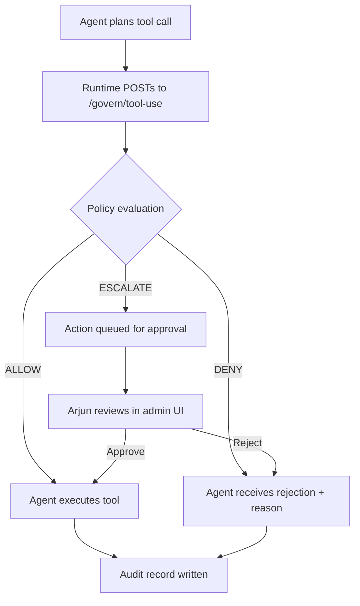

# Agentic Safety Layer (ASL) — Product Specification

**Version:** 0.1  
**Author:** Product (Principal PM draft)  
**Status:** Pre-build  
**Related:** [PROJECT_BRIEF.md](./PROJECT_BRIEF.md) · [PLAN.md](./PLAN.md)

---

## 1. Product Vision

### Vision Statement

**ASL is the external governance layer that every agent action passes through before it touches production — one policy surface, one audit trail, any framework.**

Agents should not own authorization. Policy should not live inside agent code. When an organization runs custom Groq agents, voice pipelines, and third-party frameworks side by side, there must be a single, durable place that decides whether each action is allowed — and a permanent record of that decision independent of any agent runtime.

### Strategic Position

ASL occupies the layer **above** framework-native HITL, not in competition with it for single-framework use cases. Framework HITL is embedded guardrails; ASL is the **control plane** — external, policy-driven, migration-surviving.

### Product Principles

1. **Enforce outside the agent** — Agents call out; ASL decides. No guardrail logic embedded in agent source.
2. **Policy is data, not code** — Rules are versioned, deployable artifacts. Updating policy never requires redeploying agents.
3. **Audit survives migration** — Compliance history is framework-agnostic. Switching from custom agents to LangChain does not destroy the audit trail.
4. **Graduated risk, not binary gates** — Decisions consider tool, arguments, identity, delegation chain, and session context — not just "does this tool need approval?"
5. **Self-hostable by default** — No enterprise pricing gate. A solo developer can run ASL on a VPS or locally with zero vendor dependency.
6. **Build for yourself first** — NexusFlow and OmniFlow are the first consumers. If it solves your problem, it likely solves others in the same segment.

### North Star Metric

**Percentage of production-impacting agent actions that pass through ASL and produce a complete, queryable audit record** — target 100% for integrated agents.

---

## 2. User Personas

### Persona 1: Arjun — Solo Builder / Agent Architect

| Attribute | Detail |
|-----------|--------|
| **Role** | Full-stack developer running a custom multi-agent system (NexusFlow) and building a voice pipeline (OmniFlow) |
| **Context** | 8-agent Groq stack, no LangChain. About to wire voice agents to CRM/ticketing. Works alone, no dedicated security team. |
| **Goals** | Gate destructive tool calls before they hit production. Update policies without touching agent code. One audit log across NexusFlow and OmniFlow. |
| **Pain** | Framework HITL doesn't apply to custom stacks. Enterprise control planes are overpriced and overbuilt. Policy changes mean redeploying every agent. |
| **Technical level** | High — comfortable with HTTP APIs, Docker, YAML policy files |
| **Success looks like** | Drop-in HTTP gate in front of tool calls; policy change takes effect in minutes; audit queryable by session |

**Quote:** *"I shouldn't have to redeploy eight agents because I decided DELETE actions need approval now."*

---

### Persona 2: Priya — Small Team Lead / Platform Owner

*Aspirational target persona — not a v0 build audience. v0 has one user (the builder).*

| Attribute | Detail |
|-----------|--------|
| **Role** | Tech lead at a 5–15 person startup running agents across two or more frameworks (e.g., LangChain for internal tools, custom agent for customer-facing) |
| **Context** | No dedicated compliance team. Responsible for security posture and incident response. Budget-conscious. |
| **Goals** | Single policy surface for all agents. Clear audit trail for post-incident review. Delegate approval to the right person by risk tier. |
| **Pain** | Each framework logs differently. No end-to-end view when orchestrator delegates to subagents. Can't answer "who approved this?" across systems. |
| **Technical level** | Medium-high — integrates via SDK/HTTP, configures policy, doesn't write the engine |
| **Success looks like** | One dashboard for pending approvals and audit history. Policy update propagates to all integrated agents without per-team tickets. |

**Quote:** *"We have three agent stacks and zero shared governance. One policy change shouldn't be three engineering projects."*

---

### Persona 3: Rajesh — Compliance-Conscious SMB Operator (Future)

*Aspirational target persona — not a v0 build audience.*

| Attribute | Detail |
|-----------|--------|
| **Role** | Founder/ops lead at an Indian SMB using voice agents for customer support, operating under DPDP awareness |
| **Context** | Uses third-party voice/agent vendors. Needs audit primitives vendors don't provide. Cannot afford enterprise governance platforms. |
| **Goals** | Prove who approved agent actions affecting customer data. Retain records for regulatory inquiry. Fail-closed on sensitive actions when governance is unavailable. |
| **Pain** | Vendor logs are opaque. No DPDP-native audit layer in the voice/agent stack. Legal exposure without technical audit trail. |
| **Technical level** | Low-medium — needs admin UI, not CLI. Relies on integrator or technical co-founder for setup. |
| **Success looks like** | Exportable audit reports by date range and action type. Clear record of human approvals on WRITE/DESTRUCTIVE actions. |

**Quote:** *"If a regulator asks who authorized the agent to update a customer's record, I need an answer in five minutes, not five days."*

---

### Persona 4: Dev — Agent Runtime Integrator (Secondary)

| Attribute | Detail |
|-----------|--------|
| **Role** | Developer wiring ASL into an agent framework or custom runtime |
| **Context** | Adds a pre-tool-call hook that POSTs to `/govern/tool-use` and respects allow/deny/escalate responses |
| **Goals** | Minimal integration surface. Clear request/response contract. Sensible defaults for fail-mode. |
| **Pain** | Governance APIs that require heavy SDKs or framework-specific adapters. Poor documentation on delegation-chain fields. |
| **Success looks like** | Integration in under an hour. Copy-paste examples for common patterns (sync approve, async escalate). |

**Quote:** *"Show me the HTTP contract and one working example — I'll wire the rest."*

---

## 3. User Journeys

### Journey 1: First Integration — NexusFlow Tool Gate (Arjun)

| Step | Actor | Action | System Response |
|------|-------|--------|-----------------|
| 1 | NexusFlow agent | Decides to call `update_ticket` with args | Runtime intercepts before execution |
| 2 | NexusFlow runtime | POST `/govern/tool-use` with tool, args, agent ID, session ID | ASL receives normalized action request |
| 3 | ASL policy engine | Evaluates tool against READ/WRITE/DESTRUCTIVE/CRITICAL rules + session context | Returns `ALLOW`, `DENY`, or `ESCALATE` with reason and policy version |
| 4a | Runtime (allow) | Executes tool against production API | ASL logs decision: allowed, auto, policy v3 |
| 4b | Runtime (deny) | Surfaces error to agent/user | ASL logs decision: denied, reason code |
| 4c | Runtime (escalate) | Holds action pending | ASL creates approval request, notifies via UI |
| 5 | Arjun | Reviews pending action in admin UI | Sees tool, args, risk tier, agent context |
| 6 | Arjun | Approves or rejects | ASL logs human decision with approver identity and timestamp |
| 7 | Runtime | Resumes or aborts based on decision | Audit record complete |

**Emotional arc:** Skepticism ("will this add latency?") → Relief ("policy change didn't need a redeploy") → Trust ("audit log has everything")

---

### Journey 2: Policy Update Without Redeploy (Arjun / Priya)

| Step | Actor | Action | System Response |
|------|-------|--------|-----------------|
| 1 | Operator | Identifies need: all DESTRUCTIVE actions require human approval | — |
| 2 | Operator | Edits policy YAML or admin UI rule: `DESTRUCTIVE → ESCALATE` | ASL validates policy schema |
| 3 | Operator | Deploys policy v4 (CLI or UI publish) | New version stored; previous version retained |
| 4 | ASL | All subsequent `/govern/tool-use` calls evaluate against v4 | No agent code changed |
| 5 | Operator | Queries audit: "show decisions under policy v4" | Filterable audit view |

**Key moment:** Zero agent redeployments. Policy version visible on every audit record.

---

### Journey 3: Multi-Hop Delegation (Priya)

| Step | Actor | Action | System Response |
|------|-------|--------|-----------------|
| 1 | Orchestrator agent | Delegates to subagent B on behalf of user U | Delegation chain: `[orchestrator → subagent_B]`, principal: `user:U` |
| 2 | Subagent B | Delegates to subagent C | Chain extended: `[orchestrator → subagent_B → subagent_C]` |
| 3 | Subagent C | Calls `/govern/tool-use` for `delete_record` | Request includes full delegation chain + original principal |
| 4 | ASL | Evaluates with chain context; flags scope widening if applicable | ESCALATE to tier-2 approver |
| 5 | Approver | Reviews chain: "subagent_C wants DELETE, initiated by orchestrator on behalf of user U" | Full lineage visible in approval UI |
| 6 | Approver | Decision recorded | Audit shows entire chain, not just subagent_C |

**Key moment:** Governance survives depth. Identity does not drop at hop 2.

---

### Journey 4: Fail-Mode Under Outage (Rajesh / Arjun)

| Step | Actor | Action | System Response |
|------|-------|--------|-----------------|
| 1 | Agent runtime | POST `/govern/tool-use` | ASL unreachable (network/health failure) |
| 2 | Runtime | Applies configured fail-mode per risk tier | READ → fail-open (allow with audit flag); DESTRUCTIVE → fail-closed (deny) |
| 3 | Runtime | Executes or blocks accordingly | Local log notes "ASL unavailable, fail-mode applied" |
| 4 | ASL | Recovers | Backlog sync if applicable; operator alerted to gap period |

**Key moment:** Behavior is predictable and configured — not silent or arbitrary.

---

### Journey 5: Second Consumer — OmniFlow Voice Agent (Arjun)

| Step | Actor | Action | System Response |
|------|-------|--------|-----------------|
| 1 | Voice agent (OmniFlow) | Customer request triggers CRM update tool | Same `/govern/tool-use` gate as NexusFlow |
| 2 | ASL | Evaluates WRITE action against shared policy | Same policy engine, same audit store |
| 3 | Operator | Queries audit across both systems | Single timeline: NexusFlow + OmniFlow actions |

**Key moment:** ASL is proven cross-runtime, not NexusFlow-specific.

---

## 4. Feature Breakdown

> **Priority tiers below describe the full product.** See [PLAN.md](./PLAN.md) for the v0 subset, which is smaller than P0 as labeled here.

Features are grouped into epics with priority tiers: **P0** (v1 must-have), **P1** (v1 should-have), **P2** (post-v1). P0 items tagged **v0** are in the current build; **P0-deferred** are correct v1 priority but not needed to validate the core loop.

---

### Epic A: Enforcement Gate

| ID | Feature | Priority | v0 | Description |
|----|---------|----------|-----|-------------|
| A1 | `/govern/tool-use` HTTP endpoint | P0 | **v0** | Single synchronous gate: accept normalized action request, return decision |
| A2 | Request normalization schema | P0 | **v0** | Standard fields: `tool`, `arguments`, `agent_id`, `session_id`, `timestamp`, `metadata` |
| A3 | Decision response contract | P0 | **v0** | `ALLOW`, `DENY`, `ESCALATE` with `reason`, `policy_version`, `risk_tier`, `decision_id` |
| A4 | Client timeout and retry guidance | P1 | | Documented SLA expectations; idempotency via `decision_id` / request hash |
| A5 | Batch govern endpoint | P2 | | Evaluate multiple pending actions in one call (orchestrator planning phase) |

---

### Epic B: Policy Engine

| ID | Feature | Priority | v0 | Description |
|----|---------|----------|-----|-------------|
| B1 | Risk taxonomy classification | P0 | **v0** | Map tools/actions to READ, WRITE, DESTRUCTIVE, CRITICAL |
| B2 | Rule-based policy evaluation | P0 | **v0** | YAML/JSON rules: if risk tier + conditions → decision |
| B3 | Composite context rules | P1 | | Rules over agent identity, session rejection count, argument patterns |
| B4 | Policy versioning | P0 | **v0** | Immutable versions; active policy pointer; rollback to previous version |
| B5 | Policy validation on deploy | P0 | **v0** | Schema validation; reject malformed policies before activation |
| B6 | Default deny for unclassified tools | P1 | | Unknown tools escalate or deny (configurable) |
| B7 | Risk scoring engine | P2 | | Numeric score combining multiple signals; threshold-based routing |

---

### Epic C: Human-in-the-Loop (HITL)

| ID | Feature | Priority | v0 | Description |
|----|---------|----------|-----|-------------|
| C1 | Escalation queue | P0 | **v0** | Pending actions awaiting human decision |
| C2 | Approve / reject API and UI | P0 | **v0** | Human decision resumes or blocks agent action (v0: via `scripts/approve.py`, not UI) |
| C3 | Risk-tiered approver routing | P1 | | CRITICAL → admin; DESTRUCTIVE → team lead; configurable |
| C4 | Approval timeout policy | P1 | | Auto-deny or auto-escalate after configurable TTL |
| C5 | Edit-and-approve | P2 | | Approver modifies arguments before allowing execution |
| C6 | Notification hooks | P2 | | Webhook/email/Slack on new escalation |

---

### Epic D: Delegation Chain

| ID | Feature | Priority | v0 | Description |
|----|---------|----------|-----|-------------|
| D1 | Delegation chain in request schema | P0 | | Ordered list of `{agent_id, role}` + original `principal` |
| D2 | Chain-aware audit logging | P0 | | Full chain stored on every decision record |
| D3 | Scope-widening detection | P1 | | Flag when downstream agent requests higher-risk action than upstream scope |
| D4 | Chain depth limits | P1 | | Configurable max depth; deny or escalate beyond limit |

---

### Epic E: Audit Trail

| ID | Feature | Priority | v0 | Description |
|----|---------|----------|-----|-------------|
| E1 | Append-only decision log | P0 | **v0** | Every govern call produces a durable record |
| E2 | Query API | P0 | **v0** | Filter by session, agent, time range, policy version, outcome, risk tier |
| E3 | Human approval attribution | P0 | **v0** | Approver identity, timestamp, decision on escalated actions |
| E4 | Audit export | P1 | | CSV/JSON export for date range |
| E5 | Policy version on every record | P0 | **v0** | Which policy version produced this decision |
| E6 | Integrity / tamper evidence | P2 | | Hash chain or signed records for compliance use cases |

---

### Epic F: Fail-Mode & Resilience

| ID | Feature | Priority | v0 | Description |
|----|---------|----------|-----|-------------|
| F1 | Global fail-mode config | P0 | **v0** | fail-open or fail-closed when ASL unreachable |
| F2 | Per-tier fail-mode override | P1 | | e.g., READ fail-open, DESTRUCTIVE fail-closed |
| F3 | Health check endpoint | P0 | **v0** | `/health` for runtime circuit-breaker logic |
| F4 | Degraded-mode audit flag | P1 | | Records created when fail-mode applied locally |

---

### Epic G: Admin & Operations

| ID | Feature | Priority | v0 | Description |
|----|---------|----------|-----|-------------|
| G1 | Minimal admin UI | P1 | **P0-deferred** | Pending approvals, audit viewer, active policy display |
| G2 | CLI for policy deploy and audit query | P1 | **P0-deferred** | Operator workflows without UI dependency |
| G3 | Docker Compose deployment | P0 | **P0-deferred** | Single-command self-host (dev convenience in v0; product feature deferred) |
| G4 | API authentication | P0 | **v0** | API keys or token auth for govern and admin endpoints (v0: single `ASL_API_KEY` from env; rotation, scoping, and key management API deferred) |
| G5 | Policy editor UI | P2 | | Visual rule builder; v1 uses YAML + CLI |

---

### Epic H: Integrations

| ID | Feature | Priority | v0 | Description |
|----|---------|----------|-----|-------------|
| H1 | NexusFlow integration adapter | P0 | **v0** | Pre-tool-call hook for custom Groq stack |
| H2 | OmniFlow integration adapter | P1 | | Voice pipeline tool-call gate |
| H3 | Generic Python SDK | P1 | **P0-deferred** | Thin client: `govern(tool, args, context) → decision` |
| H4 | LangChain / LangGraph middleware adapter | P2 | | Drop-in middleware for framework users |
| H5 | OpenAI Agents SDK hook | P2 | | Approval gate compatible with SDK pause/resume |

---

## 5. User Stories

Stories follow format: **As a [persona], I want [goal], so that [benefit].**  
Acceptance criteria included for P0 stories.

---

### Epic A: Enforcement Gate

**A1-US1**  
As **Arjun**, I want to POST a tool call to ASL before execution, so that no action reaches production without a policy decision.  
*AC:* Request with tool + args returns one of ALLOW/DENY/ESCALATE within documented latency budget; runtime can branch on response.

**A1-US2**  
As **Dev**, I want a documented request/response schema with examples, so that I can integrate any agent runtime in under an hour.  
*AC:* OpenAPI spec published; curl examples for all three decision outcomes.

---

### Epic B: Policy Engine

**B1-US1**  
As **Arjun**, I want tools classified into READ/WRITE/DESTRUCTIVE/CRITICAL, so that policy rules map to meaningful risk levels.  
*AC:* Policy file defines tool → tier mappings; unmapped tools handled per default rule.

**B2-US1**  
As **Priya**, I want to write rules like "DESTRUCTIVE → ESCALATE", so that destructive actions always require human approval.  
*AC:* Rule change in policy file takes effect on next deploy without agent changes.

**B4-US1**  
As **Rajesh**, I want every audit record to show which policy version applied, so that I can explain decisions during a compliance review.  
*AC:* `policy_version` field on every decision record; old versions queryable.

---

### Epic C: HITL

**C1-US1**  
As **Arjun**, I want escalated actions to appear in a pending queue, so that I can approve or reject them before they execute.  
*AC:* ESCALATE creates pending record; approve/reject transitions state; agent receives final decision.

**C2-US1**  
As **Priya**, I want to reject an escalated action with a reason, so that the agent and audit log capture why it was blocked.  
*AC:* Rejection stores reason code and optional comment; visible in audit query.

---

### Epic D: Delegation Chain

**D1-US1**  
As **Priya**, I want subagent tool calls to include the full delegation chain, so that governance doesn't break at hop 2.  
*AC:* Request schema accepts `delegation_chain[]` and `principal`; audit stores full chain.

**D2-US1**  
As **Priya**, I want to see "orchestrator → subagent_B → subagent_C requested DELETE on behalf of user U" in the approval UI, so that I can make an informed decision.  
*AC:* Approval view renders chain and principal legibly.

---

### Epic E: Audit Trail

**E1-US1**  
As **Rajesh**, I want every govern call logged regardless of outcome, so that there is a complete record of agent behavior.  
*AC:* ALLOW, DENY, and ESCALATE all produce audit records; no silent paths.

**E2-US1**  
As **Priya**, I want to query audit logs by session ID and time range, so that I can reconstruct what happened during an incident.  
*AC:* Query API supports session, agent, time range, outcome filters; returns paginated results.

**E3-US1**  
As **Rajesh**, I want human approvals to record who approved, when, and under which policy, so that I can respond to regulatory inquiry.  
*AC:* Escalated-then-approved records include approver ID, timestamp, policy version.

---

### Epic F: Fail-Mode

**F1-US1**  
As **Arjun**, I want to configure fail-closed for DESTRUCTIVE actions when ASL is down, so that outages don't become security holes.  
*AC:* Fail-mode config per tier; runtime behavior documented and testable.

**F3-US1**  
As **Dev**, I want a health endpoint, so that my runtime can detect ASL availability and apply fail-mode.  
*AC:* `/health` returns 200 when operational; documented circuit-breaker pattern.

---

### Epic G: Admin & Operations

**G3-US1**  
As **Arjun**, I want to run ASL via Docker Compose on a VPS, so that I can self-host with minimal ops overhead.  
*AC:* `docker compose up` brings up API + DB; README covers env vars and first policy deploy.

**G4-US1**  
As **Priya**, I want API key authentication on govern endpoints, so that only authorized runtimes can request decisions.  
*AC:* Unauthenticated requests rejected; keys rotatable without downtime.

---

### Epic H: Integrations

**H1-US1**  
As **Arjun**, I want a NexusFlow pre-tool-call hook that calls ASL, so that my 8-agent stack is governed immediately.  
*AC:* NexusFlow tool execution blocked until ASL returns ALLOW or approved ESCALATE.

**H2-US1**  
As **Arjun**, I want OmniFlow voice-agent tool calls to use the same ASL gate, so that voice and text agents share policy and audit.  
*AC:* OmniFlow CRM/ticketing tools pass through same endpoint and appear in unified audit timeline.

---

## 6. Risks

### Product Risks

| Risk | Likelihood | Impact | Mitigation |
|------|------------|--------|------------|
| **Scope creep toward enterprise control plane** | High | High | Strict non-goals in brief; ship NexusFlow integration before any framework adapter |
| **ASL latency breaks agent UX** | Medium | High | Sync gate must target <100ms p95 for ALLOW path; async ESCALATE pattern; cache policy in memory |
| **Solo builder can't maintain policy + infra + integrations** | Medium | Medium | YAML-first policy (no UI builder in v1); Docker Compose; CLI over UI where possible |
| **Framework-native HITL improves fast enough to reduce differentiation** | Medium | Medium | Position on cross-framework + audit + policy-without-redeploy, not pause-and-ask alone |
| **Galileo/ACP open-source captures mindshare first** | Medium | Low-Medium | Differentiate on granularity (risk taxonomy), self-host simplicity, India/SMB segment |

### Technical Risks

| Risk | Likelihood | Impact | Mitigation |
|------|------------|--------|------------|
| **Sync gate becomes bottleneck at scale** | Low (v1) | Medium | Design for single-tenant v1; document async escalation pattern early |
| **Delegation chain schema too rigid for diverse runtimes** | Medium | Medium | Extensible `metadata` bag; version schema; publish integration guide |
| **Fail-mode applied incorrectly during partial outages** | Medium | High | Per-tier defaults; explicit runtime SDK helper; integration tests for outage scenarios |
| **Audit log growth unbounded** | Medium | Low | Retention policy config; export + archive; partition by date |
| **Policy misconfiguration allows destructive actions** | Medium | Critical | Validate on deploy; default-deny for unclassified; staging policy environment |

### Market & Adoption Risks

| Risk | Likelihood | Impact | Mitigation |
|------|------------|--------|------------|
| **Target segment too small to sustain project** | Medium | Low | Primary value is personal infrastructure; open-source for community leverage |
| **Enterprise buyers want SaaS/SSO/compliance certs** | High | Low (v1) | Explicit non-goals; revisit only if traction demands |
| **DPDP positioning overpromises compliance** | Medium | Medium | Audit primitives only; no legal guarantees; document what ASL does not certify |

### Operational Risks

| Risk | Likelihood | Impact | Mitigation |
|------|------------|--------|------------|
| **Approval queue becomes stale; agents hang** | Medium | Medium | Approval TTL; auto-deny default; agent timeout handling documented |
| **Single VPS failure = governance blackout** | Medium | High | Fail-mode config; health monitoring; document HA path for future |
| **API key leakage** | Low | High | Key rotation; scoped keys per runtime; audit access separate from govern access |

---

## 7. Missing Requirements

The following are not yet specified and must be resolved before or during build. Grouped by domain.

### API & Contract

- [ ] **Exact request/response JSON schema** for `/govern/tool-use` (field names, types, required vs optional)
- [ ] **Idempotency model** — how duplicate requests for the same pending action are handled
- [ ] **Escalation resume protocol** — polling vs webhook vs long-poll for agent waiting on human decision
- [ ] **Argument redaction rules** — which fields are logged in audit vs hashed/redacted (PII, secrets)
- [ ] **Maximum request payload size** and argument serialization format

### Policy Engine

- [ ] **Policy schema v1 definition** — rule syntax, condition operators, precedence when rules conflict
- [ ] **Tool classification source of truth** — static mapping vs dynamic classification API vs hybrid
- [ ] **Session context storage** — where rejection counts and session history live; TTL
- [ ] **Policy staging environment** — dry-run / shadow mode before activating new version

### Identity & Auth

- [ ] **Agent identity model** — how `agent_id` is registered, scoped, and authenticated
- [ ] **Principal / user identity format** — OAuth subject, internal user ID, anonymous session?
- [ ] **Approver identity and authorization** — who can approve CRITICAL vs DESTRUCTIVE; RBAC model for admin UI
- [ ] **API key scoping** — per-agent keys vs org-wide keys; govern-only vs admin keys

### Delegation

- [ ] **Canonical delegation chain semantics** — who appends to chain; trust model for chain claims
- [ ] **Scope definition format** — how upstream agents declare allowed risk tiers for downstream agents
- [ ] **Chain validation** — reject forged or malformed chains?

### Audit & Compliance

- [ ] **Retention policy defaults** and configurable retention periods
- [ ] **Audit record immutability guarantees** — append-only DB, no UPDATE/DELETE on decision records
- [ ] **Export format specification** for compliance reports
- [ ] **Timezone and timestamp standard** — UTC everywhere; display localization in UI only

### HITL & UX

- [ ] **Admin UI auth mechanism** — basic auth, session login, or API-key-only for v1
- [ ] **Mobile-friendly approval** — required for on-call approvers?
- [ ] **Concurrent approval conflict** — two approvers act on same pending action
- [ ] **Agent-side timeout** — how long agent waits for ESCALATE resolution before giving up

### Integration

- [ ] **NexusFlow hook insertion point** — exact lifecycle moment (pre-tool-call, post-plan, etc.)
- [ ] **OmniFlow voice latency budget** — stricter than text agents; may need pre-approval patterns
- [ ] **SDK error handling contract** — what exceptions/return types integrators receive

### Operations

- [ ] **Observability** — metrics (decision latency, escalation queue depth), structured logging format
- [ ] **Backup and restore procedure** for PostgreSQL audit store
- [ ] **Upgrade/migration path** for policy schema changes across ASL versions
- [ ] **Rate limiting** on govern endpoint — per-agent quotas

### Legal & Positioning

- [ ] **Terms of use for audit data** — especially if opened to third-party SMB users
- [ ] **DPDP data residency** — does audit data containing customer PII need India-region hosting?

---

## 8. Future Roadmap

Roadmap is phased by outcome, not dates. No deadline per project constraints.

**See [PLAN.md](./PLAN.md) for the actual phase sequencing** — this section describes outcome-based milestones, not build order.

---

### Phase 2: HITL + Delegation (Governance Depth)

**Goal:** Multi-hop chains and human approval workflows are production-ready.

- Delegation chain in request schema + audit
- Minimal admin UI (pending queue, audit viewer)
- Risk-tiered approver routing
- Composite context rules (session rejection count, argument patterns)
- Approval TTL + timeout behavior
- Audit export (CSV/JSON)

**Exit criteria:** Multi-hop delegation visible in approval UI and audit; Priya persona journey complete.

---

### Phase 3: OmniFlow Consumer (Cross-Runtime Proof)

**Goal:** Second agent runtime shares ASL policy and audit.

- OmniFlow voice-agent tool gate integration
- Unified audit timeline across NexusFlow + OmniFlow
- Python SDK (`asl.govern(...)`)
- Scope-widening detection (basic)
- Degraded-mode audit flags

**Exit criteria:** Voice-agent CRM action governed by same policy as NexusFlow; single audit query spans both.

---

### Phase 4: Framework Adapters (Community / Segment Expansion)

**Goal:** Integrators outside the builder's stack can adopt ASL with minimal effort.

- LangChain / LangGraph middleware adapter
- Generic webhook notification on escalation
- Edit-and-approve flow
- Policy shadow/dry-run mode
- Hash chain on audit records (tamper evidence)

**Exit criteria:** External developer integrates via adapter in <1 day without forking ASL.

---

### Phase 5: SMB / Compliance Segment (Optional Commercial Path)

**Goal:** Rajesh persona can operate ASL without deep technical skill.

- Visual policy editor UI
- Pre-built DPDP-oriented audit report templates
- India-region deployment guide
- Multi-approver workflows
- SSO / team management (if team grows beyond solo)

**Exit criteria:** Non-developer operator can review audit export and manage pending approvals.

---

### Phase 6: Platform Maturity (Only If Demand Validates)

**Goal:** ASL scales beyond single-tenant self-host without becoming Kore.ai.

- HA deployment guide (multi-instance, DB replication)
- Batch govern endpoint
- Numeric risk scoring engine
- Additional framework adapters (CrewAI, OpenAI Agents SDK, Google ADK)
- Optional managed hosting (only if market pull exists)

**Explicit gate:** Enter Phase 6 only if external adoption or team growth creates demand. Do not pre-build.

---

## Appendix: Competitive Reference (Context Only)

| Competitor | Strength | ASL Differentiation |
|------------|----------|---------------------|
| Galileo Agent Control | Open-source, cross-framework, brand recognition | Lighter self-host; deeper risk taxonomy; India/SMB segment |
| Agentic Control Plane (ACP) | HTTP `/govern/tool-use` standard, delegation focus | Same architectural pattern; ASL adds granular policy + audit depth |
| Kore.ai AMP | Enterprise connectors, eval + cost attribution | ASL avoids enterprise scope; solo-dev accessible |
| Framework-native HITL | Zero integration for single-framework users | ASL for multi-framework + custom stacks only |

---

*This document is the product source of truth for ASL v0.1. Update as missing requirements are resolved and phases complete.*
